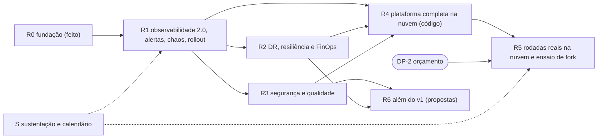

# Roadmap do lab DevOps v2: um lab completo nas três nuvens

Estado em 2026-10-14. Este arquivo é a fonte única do que falta para a família v2 virar um lab
completo de DevOps na AWS, na Azure e no Google Cloud, com tudo o que o lab v1 tinha (ou uma decisão
registrada de não ter) e o que o v1 só planejou. Cada item diz o que entregar, como provar, quanto
custa e do que depende.

O harness deste repositório confere o formato: o check `roadmap` (`make static`, obrigatório no
ruleset) exige os campos de todo item, status válidos, repositórios conhecidos, dependências que
existem e a tabela da visão geral igual aos itens; o check `family-evidence` (`make family`) confere
que todo item `feito` aponta para pull requests mesclados.

## 1. O que é "lab completo"

O lab está completo quando as cinco condições abaixo valem ao mesmo tempo:

1. Paridade com o v1: toda capacidade do v1 existe na v2, ou tem uma decisão registrada que a
   substitui ou descarta (seção "Mapa v1 → v2"). Nenhuma linha do mapa fica `pendente`.
2. Prova local: toda capacidade de plataforma e de app tem uma sonda que roda no CI do repositório
   (`verificado no CI`), sem conta de nuvem. O que só existe na nuvem tem código testado
   (`terraform test`, render, stubs) e o rótulo `não executado em nuvem (v2)` até a primeira rodada.
3. Prova na nuvem: cada par rodou pelo menos uma rodada real (apply, plataforma, deploy, smoke,
   destroy, sobras) registrada num `cloud_run_report`, com o rótulo novo
   `verificado na nuvem (v2, <data>)` (R5.5). Depende de orçamento (DP-2).
4. Coerência da família: o `make family` deste repositório fica verde (contrato, refs, versões,
   digests, arquivos idênticos, app igual nos três pares, pins das actions, links e evidências).
5. Pronto para o time: um ensaio real de fork com outra conta do GitHub passou do fork ao lab local
   (R5.7), e os rulesets exigem os checks novos (R3.12).

## 2. Onde estamos (2026-10-14)

Os seis repositórios são públicos, têm harness, CI semanal, Dependabot mensal, ruleset com checks
obrigatórios e rodam o lab local inteiro no CI. Nada da v2 rodou numa nuvem.

| Repositório | Papel | Jobs obrigatórios | Lab local | Nuvem |
|---|---|---|---|---|
| [`tx01v2`](https://github.com/maringelix/tx01v2) | infraestrutura AWS | `static`, `test`, `e2e` | 34 sondas (`full`) | `não executado em nuvem (v2)` |
| [`dx01v2`](https://github.com/maringelix/dx01v2) | app na AWS | `static`, `test`, `images`, `e2e`, `e2e-platform` | 18 sondas na plataforma do tx01v2 | `não executado em nuvem (v2)` |
| [`tx02v2`](https://github.com/maringelix/tx02v2) | infraestrutura Azure | `static`, `test`, `e2e` | 34 sondas (`full`) | `não executado em nuvem (v2)` |
| [`dx02v2`](https://github.com/maringelix/dx02v2) | app na Azure | `static`, `test`, `images`, `e2e`, `e2e-platform` | 18 sondas na plataforma do tx02v2 | `não executado em nuvem (v2)` |
| [`tx03v2`](https://github.com/maringelix/tx03v2) | infraestrutura Google Cloud | `static`, `test`, `e2e` | 34 sondas (`full`) | `não executado em nuvem (v2)` |
| [`dx03v2`](https://github.com/maringelix/dx03v2) | app no Google Cloud | `static`, `test`, `images`, `e2e`, `e2e-platform` | 18 sondas na plataforma do tx03v2 | `não executado em nuvem (v2)` |
| [`tx00v2`](https://github.com/maringelix/tx00v2) | hub da família | `static` (`family` informativo) | não se aplica | não fala com nuvem |

O que o lab local de cada par já prova (`verificado no CI`): kind 1.36 com os gêmeos locais da nuvem
(registry, PostgreSQL 17 só com TLS, object storage, load balancer, servidor git), Istio 1.31 ambient
com mTLS `STRICT` e `AuthorizationPolicy` por identidade, Gateway API com HTTPS (cert-manager, CA do
lab), External Secrets, metrics-server, Prometheus, Alertmanager (alerta entregue também como
mensagem de Slack), Grafana, Loki + Alloy, Tempo e o OpenTelemetry Collector (trace do Gateway até a
query do PostgreSQL, `trace_id` nos logs, exemplars), Argo CD (commit, sync, self-heal), Gatekeeper
em `deny`, Trivy Operator, Velero (restore de namespace com dados) e Chaos Mesh com hipóteses (pod
kill, latência, stress, latência entre a API e o banco), além do rollout sem downtime do app.

O que existe só como código (`não executado em nuvem (v2)`): bootstrap (state, identidades OIDC ou
Workload Identity Federation, budget), apply do lab (rede, EKS/AKS/GKE Autopilot 1.36, PostgreSQL 17
gerenciado, registry, WAF, contrato), camada de plataforma mínima (controlador de entrada, ESO e
Collector com exportador de traces da nuvem), deploy do app e destroy com checagem de sobras.

Custos de referência de uma rodada de 3 horas com os padrões (fonte: `docs/CUSTOS.md` de cada
repositório de infraestrutura): AWS cerca de US$0,80 a 1,00
([CUSTOS do tx01v2](https://github.com/maringelix/tx01v2/blob/main/docs/CUSTOS.md)), Azure cerca de
US$1,50 ([CUSTOS do tx02v2](https://github.com/maringelix/tx02v2/blob/main/docs/CUSTOS.md)), Google
Cloud cerca de US$0,40 com o free tier da GKE e US$0,70 sem
([CUSTOS do tx03v2](https://github.com/maringelix/tx03v2/blob/main/docs/CUSTOS.md)).

## 3. Como ler e como executar

Campos de todo item: `Status`, `Repos`, `Origem`, `Dependências`, `Custo`, `Entregáveis`, `Aceite`
e, quando `feito`, `Evidência` (links dos PRs mesclados).

| Status | Significado |
|---|---|
| `feito` | mesclado com o CI verde; a evidência aponta os PRs |
| `em andamento` | PR aberto ou parte dos repositórios mesclada |
| `pendente` | aceito, ainda não começou |
| `bloqueado` | depende de algo fora dos repositórios (orçamento, conta, decisão) |
| `proposta` | além do v1; precisa do OK do Bruno antes de virar `pendente` |

| Origem | Significado |
|---|---|
| v1 implementado | o v1 tinha; a v2 precisa da paridade |
| v1 planejado | estava nos planos do v1 (as "Melhorias futuras" do tx01, as auditorias, a "Evolução Contínua" da apresentação pública do lab) e nunca foi feito |
| dívida v2 | encontrado ao construir a v2 |
| proposta v2 | não existia no v1 |

Regras de execução (as mesmas da v2 desde o início; detalhes em [docs/GUARDRAILS.md](docs/GUARDRAILS.md)):

1. Uma rodada por vez. O `tx01v2` e o `dx01v2` são a referência: o item nasce neles e é portado para
   o `tx02v2`/`tx03v2` e o `dx02v2`/`dx03v2` na mesma rodada, só com renomeações e o que a nuvem exige.
2. Um PR por repositório por rodada, com o CI verde antes do merge; o tx entra antes do dx, e o PR do
   dx fixa o commit mesclado do tx em `deploy/local/tx0Nv2.ref`.
3. Primeiro local, com sonda no CI; depois o código da nuvem, com testes, rótulo
   `não executado em nuvem (v2)` e o custo no `docs/CUSTOS.md`. Nada é aplicado numa nuvem sem um
   pedido explícito do Bruno para aquela ação.
4. Mudança de contrato: PRs coordenados nos dois lados e versão nova (`docs/CONTRATO.md`).
5. Nada de enfraquecer gate (`continue-on-error`, `|| true`, check pulado, ignore sem `statement` e
   `expired_at`), tudo fixado (versão + SHA256, SHA de 40 caracteres, digest).
6. Ao fim da rodada: este roadmap (status, evidência), o `docs/HISTORICO.md` e o `CHANGELOG.md` deste
   repositório, num commit só de documentação.

## 4. Visão geral

| ID | Item | Status |
|---|---|---|
| R0.1 | Os seis repositórios v2 públicos, com harness, CI e guardrails | `feito` |
| R0.2 | O mesmo app nos três pares (regra de paridade) | `feito` |
| R0.3 | Lab local com a plataforma completa do v1 | `feito` |
| R0.4 | O lab local como gate de merge | `feito` |
| R0.5 | Pronto para fork | `feito` |
| R0.6 | Hub da família (este repositório) | `feito` |
| R0.7 | Scripts que só agem no lab (segurança para quem faz fork) | `feito` |
| R1.1 | Traces na plataforma local | `feito` |
| R1.2 | Alertas no Slack | `feito` |
| R1.3 | Chaos com hipóteses: latência de rede e stress | `feito` |
| R1.4 | Traces no app e contrato v2 | `feito` |
| R1.5 | Rollout sem downtime e latência entre a API e o banco | `feito` |
| R1.6 | Exportadores de traces das nuvens, como código | `feito` |
| R1.7 | Dívida: SHA256 do chart do Collector na nuvem do tx01v2 | `pendente` |
| R1.8 | Dívida: perfil enxuto do e2e-platform para máquinas com menos de 8 GB | `pendente` |
| R1.9 | Dívida: instalação instável do servidor do Trivy Operator | `pendente` |
| R1.10 | Dívida: timeout do webhook do ESO no lab local do tx03v2 | `pendente` |
| R2.1 | Perfil `dr` no lab local: região B, banco standby e backup replicado | `pendente` |
| R2.2 | Failover do app entre as regiões do lab local | `pendente` |
| R2.3 | Falha de nó: kind com vários nós | `pendente` |
| R2.4 | DR na nuvem como código, opcional | `pendente` |
| R2.5 | RTO e RPO por nuvem, runbook de failover e failback | `pendente` |
| R2.6 | OpenCost no lab local com os preços de cada nuvem | `pendente` |
| R2.7 | Labels de custo e showback | `pendente` |
| R2.8 | Rightsizing com recomendações do VPA | `pendente` |
| R2.9 | Spot opcional no AKS e no GKE Autopilot | `pendente` |
| R2.10 | Autoscaling de nós no EKS | `pendente` |
| R3.1 | SonarQube Community Build no harness | `pendente` |
| R3.2 | OWASP ZAP baseline no e2e do kind | `pendente` |
| R3.3 | Cloud Armor com a cobertura do v1 | `pendente` |
| R3.4 | Paridade dos WAFs das três nuvens | `pendente` |
| R3.5 | WAF no lab local (Coraza + OWASP CRS) | `proposta` |
| R3.6 | ACME com Pebble no lab local | `pendente` |
| R3.7 | HTTPS nas três nuvens (contrato v3) | `bloqueado` |
| R3.8 | Gerência de tráfego no Istio ambient | `pendente` |
| R3.9 | Cadeia de suprimentos: SBOM, assinatura e verificação na admissão | `pendente` |
| R3.10 | Permission boundary no papel de apply da AWS | `pendente` |
| R3.11 | CodeQL no app | `proposta` |
| R3.12 | Checks novos obrigatórios nos rulesets | `pendente` |
| R3.13 | `leftovers.sh` da Azure e do Google Cloud só culpam o que é do lab | `pendente` |
| R3.14 | Destroy que sempre chega ao fim | `pendente` |
| R3.15 | OIDC e Workload Identity Federation presos a IDs imutáveis e à `main` | `pendente` |
| R3.16 | Papéis de CI mais estreitos fora de uma conta dedicada | `pendente` |
| R3.17 | Logs públicos sem identificadores e smoke sem token em texto puro | `pendente` |
| R3.18 | Efeitos colaterais na máquina de quem faz fork | `pendente` |
| R4.1 | Perfis `core` e `full` da camada de plataforma na nuvem | `pendente` |
| R4.2 | ADR: observabilidade no cluster ou gerenciada, por nuvem | `pendente` |
| R4.3 | Istio ambient nas três nuvens | `pendente` |
| R4.4 | Argo CD na nuvem e deploy do app por GitOps | `pendente` |
| R4.5 | Velero com o object storage de cada nuvem | `pendente` |
| R4.6 | Gatekeeper, Trivy Operator e Chaos Mesh na nuvem | `pendente` |
| R4.7 | Dimensionamento e custo do perfil `full` | `pendente` |
| R5.1 | Contas, orçamento e aprovação das rodadas em nuvem | `bloqueado` |
| R5.2 | Primeira rodada na AWS | `bloqueado` |
| R5.3 | Primeira rodada na Azure | `bloqueado` |
| R5.4 | Primeira rodada no Google Cloud | `bloqueado` |
| R5.5 | Rótulo `verificado na nuvem (v2, <data>)` | `pendente` |
| R5.6 | Perguntas que só a nuvem responde | `bloqueado` |
| R5.7 | Ensaio real de fork com outra conta do GitHub | `bloqueado` |
| R6.1 | Entrega progressiva com Argo Rollouts | `proposta` |
| R6.2 | SLOs como código e alertas de burn rate | `proposta` |
| R6.3 | Teste de carga com k6 e HPA sob carga | `proposta` |
| R6.4 | Proveniência SLSA das imagens | `proposta` |
| R6.5 | Métricas DORA da família | `proposta` |
| R6.6 | Game day documentado | `proposta` |
| R6.7 | Failover entre nuvens | `proposta` |
| R6.8 | Rotação de segredos provada | `proposta` |
| S.1 | Node.js 26 LTS nos apps | `pendente` |
| S.2 | Kubernetes 1.37 na família e kubectl alinhado | `pendente` |
| S.3 | Istio 1.31 para 1.33 | `pendente` |
| S.4 | Exceções do trivy que vencem em 2027-04-30 | `pendente` |
| S.5 | nginx 1.32 nos apps | `pendente` |
| S.6 | Amazon Linux 2023 nos nós do EKS | `pendente` |
| S.7 | Schemas de CRD do kubeconform | `pendente` |
| S.8 | Menções a "contract v1" que descrevem a versão 2 | `pendente` |
| S.9 | Primeira revisão trimestral conjunta da família | `pendente` |

## 5. Dependências entre as fases

R2 e R3 podem andar em paralelo (repositórios e sondas diferentes). R4 depende só de R1 para
começar, mas fica mais barata depois de R2 e R3, porque a plataforma da nuvem leva junto o que elas
adicionarem. R5 depende de dinheiro e de aprovação, não de código: pode acontecer a qualquer momento
para a camada mínima que já existe.

## R0. Fundação da v2

### R0.1 Os seis repositórios v2 públicos, com harness, CI e guardrails

- Status: `feito`
- Repos: tx01v2, dx01v2, tx02v2, dx02v2, tx03v2, dx03v2
- Origem: dívida v2 (reconstrução do v1 com prova local e rótulos honestos)
- Dependências: nenhuma
- Custo: nenhum (GitHub Actions de repositórios públicos)
- Entregáveis:
  - `scripts/harness.sh` com estágios `static`, `test` e, nos dx, `build` e `e2e` (kind); ferramentas
    fixadas por versão e SHA256 (`tools/`), actions por SHA de 40 caracteres, imagens por digest.
  - CI = harness (`ci.yml` só chama `make`), `HARNESS_STRICT=1`, CI semanal, Dependabot mensal.
  - Ruleset como código (`.github/rulesets/main.json`) e `scripts/repo-guardrails.sh`, aplicado e
    lido de volta com `gh api` em 2026-10-14.
  - Docs em pt-BR (arquitetura, contrato, runbook, custos, guardrails, harness, sustentação,
    publicação, lições do v1).
- Aceite:
  - CI verde nos seis; linhas `verificado no CI` só depois do primeiro CI verde.
- Evidência: [tx01v2#1](https://github.com/maringelix/tx01v2/pull/1), [dx01v2#3](https://github.com/maringelix/dx01v2/pull/3), [tx02v2#1](https://github.com/maringelix/tx02v2/pull/1), [dx02v2#1](https://github.com/maringelix/dx02v2/pull/1), [tx03v2#1](https://github.com/maringelix/tx03v2/pull/1), [dx03v2#3](https://github.com/maringelix/dx03v2/pull/3), [tx01v2#2](https://github.com/maringelix/tx01v2/pull/2), [tx01v2#3](https://github.com/maringelix/tx01v2/pull/3), [tx02v2#2](https://github.com/maringelix/tx02v2/pull/2), [tx03v2#2](https://github.com/maringelix/tx03v2/pull/2)

### R0.2 O mesmo app nos três pares (regra de paridade)

- Status: `feito`
- Repos: dx01v2, dx02v2, dx03v2
- Origem: dívida v2 (no v1 cada nuvem tinha um app diferente: Node 20 com PostgreSQL, SQL Server, TypeScript com Tailwind)
- Dependências: R0.1
- Custo: nenhum
- Entregáveis:
  - O app do `dx01v2` (commit `22e69c4`: Express 5 + TypeScript, React 19 em nginx-unprivileged,
    PostgreSQL 17) nos três repositórios de app; só o alvo de deploy muda.
  - Regra de paridade no `AGENTS.md` de cada dx e rotina no `docs/SUSTENTACAO.md`.
  - Os casos de teste de `X-Forwarded-For` do AGC e do load balancer do Google portados para os três.
- Aceite:
  - O check `family-app` deste repositório: mesmas dependências e o mesmo código em `api/src` e
    `web/src`, a menos de nomes e comentários.
- Evidência: [dx01v2#4](https://github.com/maringelix/dx01v2/pull/4), [dx01v2#5](https://github.com/maringelix/dx01v2/pull/5), [dx02v2#2](https://github.com/maringelix/dx02v2/pull/2), [dx03v2#4](https://github.com/maringelix/dx03v2/pull/4)

### R0.3 Lab local com a plataforma completa do v1

- Status: `feito`
- Repos: tx01v2, dx01v2, tx02v2, dx02v2, tx03v2, dx03v2
- Origem: v1 implementado (a plataforma do v1 só existia na nuvem, instalada por workflows)
- Dependências: R0.1
- Custo: local, grátis; 8 GB de memória do Docker para o perfil `full` (3 GB para o `core`)
- Entregáveis:
  - `terraform/envs/local` (provider Docker): kind, gêmeos locais do registry, do banco (PostgreSQL 17
    só com TLS), do object storage, do load balancer e do GitHub (servidor git).
  - `platform/local` com perfis `core`, `observability`, `operations` e `full`, contrato local
    (`lab-system/lab-contract`), `check.sh` com as sondas e `uninstall.sh` sem sobras.
  - Nos dx: overlay `local-platform`, `scripts/deploy-local.sh` (GitOps pelo Argo CD) e
    `scripts/e2e-platform.sh`.
- Aceite:
  - `make e2e` (tx) e `make e2e-platform` (dx) verdes no CI, com destroy e checagem de sobras.
- Evidência: [tx01v2#5](https://github.com/maringelix/tx01v2/pull/5), [tx01v2#6](https://github.com/maringelix/tx01v2/pull/6), [tx02v2#3](https://github.com/maringelix/tx02v2/pull/3), [tx02v2#4](https://github.com/maringelix/tx02v2/pull/4), [tx03v2#3](https://github.com/maringelix/tx03v2/pull/3), [dx01v2#6](https://github.com/maringelix/dx01v2/pull/6), [dx02v2#3](https://github.com/maringelix/dx02v2/pull/3), [dx03v2#5](https://github.com/maringelix/dx03v2/pull/5)

### R0.4 O lab local como gate de merge

- Status: `feito`
- Repos: tx01v2, dx01v2, tx02v2, dx02v2, tx03v2, dx03v2
- Origem: dívida v2
- Dependências: R0.3
- Custo: cerca de 30 a 50 minutos de runner por PR (gratuito em repositórios públicos)
- Entregáveis:
  - Jobs `e2e` (tx) e `e2e-platform` (dx) exigidos pelo ruleset, aplicados com
    `scripts/repo-guardrails.sh`.
- Aceite:
  - O ruleset lido de volta com `gh api` lista os jobs; o check `family-identical` exige o mesmo
    ruleset dentro de cada papel.
- Evidência: [tx01v2#7](https://github.com/maringelix/tx01v2/pull/7), [tx02v2#5](https://github.com/maringelix/tx02v2/pull/5), [tx03v2#4](https://github.com/maringelix/tx03v2/pull/4), [dx01v2#7](https://github.com/maringelix/dx01v2/pull/7), [dx02v2#4](https://github.com/maringelix/dx02v2/pull/4), [dx03v2#6](https://github.com/maringelix/dx03v2/pull/6)

### R0.5 Pronto para fork

- Status: `feito`
- Repos: tx01v2, dx01v2, tx02v2, dx02v2, tx03v2, dx03v2
- Origem: dívida v2 (o time do Bruno aprende fazendo fork dos pares)
- Dependências: R0.1
- Custo: nenhum
- Entregáveis:
  - `FORK.md` em cada repositório: o que o GitHub não copia, o lab local, a própria conta de nuvem.
  - `github_owner` sem valor padrão nos bootstraps; `repo-guardrails.sh` liga issues, aprovação de
    runs de forks e para com uma mensagem clara enquanto as Actions do fork estão desligadas.
  - O e2e-platform dos dx clona o repositório tx configurado (`TX0NV2_REPO`).
- Aceite:
  - Devcontainers verificados com `LOCAL_PROFILE=core make e2e` dentro (2026-10-14); o ensaio com uma
    segunda conta do GitHub continua em R5.7.
- Evidência: [tx01v2#8](https://github.com/maringelix/tx01v2/pull/8), [tx02v2#6](https://github.com/maringelix/tx02v2/pull/6), [tx03v2#5](https://github.com/maringelix/tx03v2/pull/5), [dx01v2#8](https://github.com/maringelix/dx01v2/pull/8), [dx02v2#5](https://github.com/maringelix/dx02v2/pull/5), [dx03v2#7](https://github.com/maringelix/dx03v2/pull/7)

### R0.6 Hub da família (este repositório)

- Status: `feito`
- Repos: tx00v2, tx01v2, dx01v2, tx02v2, dx02v2, tx03v2, dx03v2
- Origem: proposta v2 (no v1, o `tx00` era um rastreador privado de auditorias)
- Dependências: R0.1
- Custo: nenhum
- Entregáveis:
  - Este repositório: README com as referências, este roadmap, guardrails da família
    ([docs/GUARDRAILS.md](docs/GUARDRAILS.md)), harness com os estágios `static` (obrigatório) e
    `family` (os checks entre os repositórios), histórico ([docs/HISTORICO.md](docs/HISTORICO.md)).
  - A linha do `tx00v2` na tabela da família dos seis READMEs.
- Aceite:
  - CI verde (`static` e `family`), ruleset aplicado e lido de volta; o check `family-table` acha o
    hub nos doze READMEs dos seis repositórios.
- Evidência: [tx01v2#10](https://github.com/maringelix/tx01v2/pull/10), [dx01v2#10](https://github.com/maringelix/dx01v2/pull/10), [tx02v2#8](https://github.com/maringelix/tx02v2/pull/8), [tx03v2#6](https://github.com/maringelix/tx03v2/pull/6), [dx02v2#6](https://github.com/maringelix/dx02v2/pull/6), [dx03v2#8](https://github.com/maringelix/dx03v2/pull/8)

### R0.7 Scripts que só agem no lab (segurança para quem faz fork)

- Status: `feito`
- Repos: tx01v2, dx01v2, tx02v2, dx02v2, tx03v2, dx03v2
- Origem: auditoria de segurança para forks (2026-10-14): o que poderia quebrar a máquina ou a nuvem
  de quem faz fork
- Dependências: R0.5
- Custo: nenhum
- Entregáveis:
  - Os scripts de nuvem não escolhem o alvo por variável de ambiente genérica (`CLUSTER_NAME`,
    `RESOURCE_GROUP`, `LAB_*`): o alvo vem do contrato e é conferido pela tag `Project` (AWS, Azure)
    ou pelo label `project` (Google Cloud) do cluster antes de qualquer mudança (`require_lab_cluster`).
  - Kubeconfig de nuvem em arquivo temporário nos scripts e num arquivo próprio nos outputs e nos
    runbooks: o `~/.kube/config` e o contexto atual de quem roda não mudam, e o kubelogin da Azure só
    converte esse arquivo.
  - Os scripts de `platform/local` e o `scripts/deploy-local.sh` só falam com o contexto
    `kind-tx0Nv2-local` (`require_lab_context`).
  - Os testes de integração dos apps, que apagam e recriam tabelas, só aceitam um banco cujo nome
    termina em `_test` (no helper e no harness); os runbooks mostram um banco `*_test` separado.
  - O `leftovers.sh` da AWS só conta como sobra o Elastic IP com a tag do lab; o PostgreSQL da Azure
    leva o sufixo da assinatura no nome (nome DNS global, que bloqueava o apply do lab de outro fork).
  - Check estático `policy-scripts` nos três tx (SEC-10, SEC-14 e SEC-16 nos guardrails de cada um),
    SEC-07, SEC-08 e SEC-09 nos dx e a regra SEC-05 da família.
- Aceite:
  - `HARNESS_STRICT=1 make verify` local e CI verde nos seis (`static`, `test`, `e2e`; nos dx também
    `images` e `e2e-platform`); a trava do banco provada nos dois sentidos (aceita `dx01v2_test`,
    recusa `dx01v2` antes de conectar, no harness e no vitest direto).
- Evidência: [tx01v2#11](https://github.com/maringelix/tx01v2/pull/11), [tx02v2#9](https://github.com/maringelix/tx02v2/pull/9), [tx03v2#8](https://github.com/maringelix/tx03v2/pull/8), [dx01v2#11](https://github.com/maringelix/dx01v2/pull/11), [dx02v2#7](https://github.com/maringelix/dx02v2/pull/7), [dx03v2#9](https://github.com/maringelix/dx03v2/pull/9)

## R1. Observabilidade 2.0, alertas, chaos e rollout sem downtime

A rodada que trouxe o que faltava do v1 na observabilidade e a última etapa do roadmap do v1 que
nunca começou ("Observability 2.0", com OpenTelemetry). Contrato local e de nuvem na versão 2 (a
chave nova é o endpoint OTLP do Collector).

### R1.1 Traces na plataforma local

- Status: `feito`
- Repos: tx01v2, tx02v2, tx03v2
- Origem: v1 planejado ("Observability 2.0" com OpenTelemetry; o v1 tinha só Application Insights e o Jaeger do Istio)
- Dependências: R0.3
- Custo: local, cerca de 0,5 GB a mais no perfil `observability`
- Entregáveis:
  - OpenTelemetry Collector (chart 0.176.0, imagem contrib por digest) e Tempo (chart
    `grafana-community/tempo` 3.1.0) no perfil `observability`.
  - Spans do Istio Gateway pela Telemetry API, com W3C trace context; `extensionProviders` no istiod.
  - Conector spanmetrics com exemplars e ServiceMonitor de 10 s (o exemplar vive um flush de 15 s).
  - Datasources do Grafana ligando Tempo, Loki e Prometheus.
- Aceite:
  - Sonda `check_tracing`: trace OTLP no Tempo, span do Gateway, métrica do spanmetrics com
    exemplar, links do Grafana; 22 sondas no perfil `observability` e 34 no `full`.
- Evidência: [tx01v2#9](https://github.com/maringelix/tx01v2/pull/9), [tx02v2#7](https://github.com/maringelix/tx02v2/pull/7), [tx03v2#6](https://github.com/maringelix/tx03v2/pull/6)

### R1.2 Alertas no Slack

- Status: `feito`
- Repos: tx01v2, tx02v2, tx03v2
- Origem: v1 implementado (Alertmanager com receivers do Slack nas três nuvens)
- Dependências: R0.3
- Custo: nenhum
- Entregáveis:
  - Receiver do Slack no Alertmanager com o webhook lido de um Secret opcional; sem o Secret, nada
    sai do cluster.
  - No CI, o webhook aponta para o alert sink do lab, que guarda o payload.
- Aceite:
  - Sonda `check_slack`: o alerta sintético chega no formato de mensagem do Slack.
- Evidência: [tx01v2#9](https://github.com/maringelix/tx01v2/pull/9), [tx02v2#7](https://github.com/maringelix/tx02v2/pull/7), [tx03v2#6](https://github.com/maringelix/tx03v2/pull/6)

### R1.3 Chaos com hipóteses: latência de rede e stress

- Status: `feito`
- Repos: tx01v2, tx02v2, tx03v2
- Origem: v1 implementado (Chaos Mesh manual no tx02 do v1: pod, latência, CPU e memória)
- Dependências: R0.3
- Custo: nenhum
- Entregáveis:
  - NetworkChaos de 100 ms e StressChaos de CPU e memória, cada um com hipótese escrita e medida.
- Aceite:
  - Sondas do perfil `operations` (24): a mediana da latência sobe como previsto, o pico de CPU e
    memória aparece nas métricas e nenhum container reinicia.
- Evidência: [tx01v2#9](https://github.com/maringelix/tx01v2/pull/9), [tx02v2#7](https://github.com/maringelix/tx02v2/pull/7), [tx03v2#6](https://github.com/maringelix/tx03v2/pull/6)

### R1.4 Traces no app e contrato v2

- Status: `feito`
- Repos: dx01v2, dx02v2, dx03v2
- Origem: v1 planejado ("Observability 2.0")
- Dependências: R1.1
- Custo: nenhum
- Entregáveis:
  - Spans manuais na API (SERVER por requisição com o nome da rota, CLIENT por query do PostgreSQL,
    só SQL parametrizado), `traceparent` continuado, OTLP/HTTP para `OTEL_EXPORTER_OTLP_ENDPOINT`
    (desligado sem ele), `trace_id`/`span_id` nos logs, OpenMetrics com o trace id como exemplar,
    flush de no máximo 5 s no desligamento.
  - Dependências fixadas: `@opentelemetry/api` 1.9.1, `sdk-trace-node` 2.12.0,
    `exporter-trace-otlp-http` 0.223.0, `resources` 2.12.0, `semantic-conventions` 1.43.0.
  - Contrato v2: `deploy-local.sh` exige a versão 2 do contrato local e espera o sync do commit que
    enviou; NetworkPolicies API → Collector (4318) e Gateway → Collector (4317), as duas por HBONE
    (15008); o componente de nuvem manda os traces para `observability:4318`.
- Aceite:
  - Sonda de traces do `e2e-platform`: um trace no Tempo do Gateway até a query, o `trace_id` no Loki
    e num exemplar; testes de unidade e integração com o processador em memória.
- Evidência: [dx01v2#9](https://github.com/maringelix/dx01v2/pull/9), [dx02v2#6](https://github.com/maringelix/dx02v2/pull/6), [dx03v2#8](https://github.com/maringelix/dx03v2/pull/8)

### R1.5 Rollout sem downtime e latência entre a API e o banco

- Status: `feito`
- Repos: dx01v2, dx02v2, dx03v2
- Origem: v1 implementado (rolling update e PDB no v1, sem prova de zero erro)
- Dependências: R1.4
- Custo: nenhum
- Entregáveis:
  - `check_zero_downtime`: um redeploy por GitOps com uma tag nova enquanto um leitor faz requisições.
  - `check_chaos_db_latency`: NetworkChaos de 200 ms entre a API e o PostgreSQL.
- Aceite:
  - O leitor termina sem nenhuma requisição com erro; o span do `SELECT` mostra pelo menos 190 ms
    sob o chaos e as leituras continuam; 18 sondas no `e2e-platform`.
- Evidência: [dx01v2#9](https://github.com/maringelix/dx01v2/pull/9), [dx02v2#6](https://github.com/maringelix/dx02v2/pull/6), [dx03v2#8](https://github.com/maringelix/dx03v2/pull/8)

### R1.6 Exportadores de traces das nuvens, como código

- Status: `feito`
- Repos: tx01v2, tx02v2, tx03v2
- Origem: v1 planejado ("Observability 2.0" nas nuvens)
- Dependências: R1.1
- Custo: AWS X-Ray com 100 mil traces por mês sem custo; Cloud Trace com 2,5 milhões de spans por
  mês sem custo; Application Insights com teto de 0,5 GB por dia (detalhes nos `docs/CUSTOS.md`)
- Entregáveis:
  - AWS: exportador `awsxray` e papel do Pod Identity do Collector com `AWSXRayDaemonWriteAccess`.
  - Azure: Application Insights sempre ligado (DEC-6), autenticação local desligada, identidade
    federada do Collector com o papel Monitoring Metrics Publisher, extensão `azure_auth` e exportador
    `azure_monitor`.
  - Google Cloud: exportador `googlecloud`, `roles/cloudtrace.agent` para o principal do service
    account do Kubernetes do Collector e a API do Cloud Trace no bootstrap.
- Aceite:
  - `terraform test` e `helm template` no CI (`verificado no CI`); a nuvem continua
    `não executado em nuvem (v2)`. Antes da primeira rodada, reaplicar os bootstraps do tx02v2 (lista
    do ABAC) e do tx03v2 (API do Cloud Trace).
- Evidência: [tx01v2#9](https://github.com/maringelix/tx01v2/pull/9), [tx02v2#7](https://github.com/maringelix/tx02v2/pull/7), [tx03v2#6](https://github.com/maringelix/tx03v2/pull/6)

### R1.7 Dívida: SHA256 do chart do Collector na nuvem do tx01v2

- Status: `pendente`
- Repos: tx01v2
- Origem: dívida v2 (achada no porte da R1)
- Dependências: nenhuma
- Custo: nenhum
- Entregáveis:
  - O SHA256 do arquivo do chart do Collector sai de `platform/local/versions.env`
    (`OTEL_COLLECTOR_SHA256`) e vai para `platform/versions.env` como `OTEL_COLLECTOR_CHART_SHA256`,
    usado pela nuvem e pelo lab local, como no tx02v2 e no tx03v2.
  - `platform/install.sh` baixa o arquivo, confere o SHA256 e instala a partir dele.
- Aceite:
  - `helm-template` e `local-versions` verdes; o `family-versions` mostra a mesma chave nos três tx.

### R1.8 Dívida: perfil enxuto do e2e-platform para máquinas com menos de 8 GB

- Status: `pendente`
- Repos: tx01v2, tx02v2, tx03v2, dx01v2, dx02v2, dx03v2
- Origem: dívida v2 (o perfil `full` com o app passa dos 7,65 GiB do Docker Desktop usado no desenvolvimento; as sondas novas da R1 só rodaram no CI)
- Dependências: R1.5
- Custo: local, grátis; o objetivo é caber em 6 GB
- Entregáveis:
  - Um perfil de recursos `small` no `platform/local/install.sh` (requests e limits menores, uma
    réplica por componente, retenção curta no Prometheus, no Loki e no Tempo), escolhido por variável;
    os componentes continuam os mesmos, porque as sondas do app usam quase todos.
  - O `scripts/e2e-platform.sh` dos dx aceita o perfil e o `docs/LAB_LOCAL.md` diz quanto cada perfil
    precisa, medido.
- Aceite:
  - As 18 sondas passam com o Docker limitado a 6 GB (rodada local registrada nos `docs/LAB_LOCAL.md`);
    o CI continua com o perfil padrão.

### R1.9 Dívida: instalação instável do servidor do Trivy Operator

- Status: `pendente`
- Repos: tx01v2, tx02v2, tx03v2
- Origem: dívida v2 (uma rodada do `e2e` do tx01v2#9 falhou com o servidor embutido do Trivy em CrashLoop na instalação; a seguinte passou)
- Dependências: nenhuma
- Custo: nenhum
- Entregáveis:
  - Com o diagnóstico de instalação já adicionado, achar a causa se a falha voltar (recursos, probes
    ou o cache do servidor no modo ClientServer) e corrigir nos values dos três tx.
- Aceite:
  - Dez rodadas seguidas do job `e2e` verdes nos três tx (PRs e CI semanal), ou a causa documentada
    no `docs/LICOES_APRENDIDAS.md` com a correção.

### R1.10 Dívida: timeout do webhook do ESO no lab local do tx03v2

- Status: `pendente`
- Repos: tx03v2
- Origem: dívida v2 (duas rodadas locais do perfil `observability` falharam na sonda do External Secrets com `context deadline exceeded` no webhook; o CI passou)
- Dependências: nenhuma
- Custo: nenhum
- Entregáveis:
  - Os values locais do ESO sem os limites de CPU do Autopilot (50m no webhook e no cert controller,
    100m no controller), que hoje vêm de `platform/values/external-secrets.yaml`; requests menores.
- Aceite:
  - Três rodadas locais seguidas do perfil `observability` verdes num Docker de 8 GB, sem mudar a
    sonda.

## R2. DR multirregião, resiliência e FinOps

Nada disso existiu no v1: tudo era de uma região só, e FinOps era um budget e workflows de escala.
Primeiro tudo é provado no lab local; a nuvem vem como código opcional.

### R2.1 Perfil `dr` no lab local: região B, banco standby e backup replicado

- Status: `pendente`
- Repos: tx01v2, tx02v2, tx03v2
- Origem: v1 planejado ("Multi-region failover" nas melhorias futuras do tx01 v1; DR multirregião na "Evolução Contínua")
- Dependências: R1.8
- Custo: local, grátis; dois clusters com o perfil `core` e dois bancos pedem cerca de 8 GB, então a
  rodada completa fica no CI (runner de 16 GB) ou em máquinas com 10 GB ou mais; um job de CI a mais,
  de 30 a 40 minutos
- Entregáveis:
  - `terraform/envs/local` com `enable_dr` (padrão `false`): um segundo cluster kind (a "região B"), um
    PostgreSQL 17 standby com replicação física em streaming por TLS e um bucket B no emulador de
    object storage, com a cópia dos backups.
  - `platform/local/install.sh` com o perfil `dr`: `core` nos dois clusters, Velero nos dois (o B lê o
    bucket replicado) e o Argo CD do B apontando para o mesmo servidor git.
  - `scripts/local-lab.sh failover` e `failback`: para a região A (nós do kind e banco primário),
    promove o standby, move o nome do banco do contrato local para o novo primário e restaura os
    namespaces no B.
  - Sondas no `platform/local/check.sh` e um estágio novo `e2e-dr` (`make e2e-dr`, job de CI `e2e-dr`).
  - `docs/LAB_LOCAL.md` (seção DR) e um ADR no `docs/ARQUITETURA.md`.
- Aceite:
  - Replicação com atraso abaixo de 5 s sob escrita; a cópia do backup aparece no bucket B.
  - Drill de failover medido e impresso: RPO (linhas escritas antes da falha que faltam depois da
    promoção) de no máximo 5 s de escrita e RTO (da parada da região A à primeira escrita no B) de no
    máximo 15 minutos.
  - Destroy sem sobras (`scripts/leftovers-local.sh`).

### R2.2 Failover do app entre as regiões do lab local

- Status: `pendente`
- Repos: dx01v2, dx02v2, dx03v2
- Origem: v1 planejado (DR multirregião)
- Dependências: R2.1
- Custo: local, grátis; mesmo limite de memória da R2.1
- Entregáveis:
  - O deploy por GitOps nas duas regiões (uma Application do Argo CD em cada cluster) e o app lendo o
    endereço do banco pelo contrato local, que muda na promoção (contrato local versão 3, coordenado
    com a R2.1).
  - `scripts/e2e-dr.sh` e o job de CI `e2e-dr`: escreve mensagens na região A, dispara o failover do
    tx, sincroniza no B e roda o smoke no B.
- Aceite:
  - As mensagens escritas antes da falha estão no B (menos as do RPO medido), escritas funcionam
    depois da promoção e o tempo total fica dentro do RTO da R2.1.

### R2.3 Falha de nó: kind com vários nós

- Status: `pendente`
- Repos: tx01v2, tx02v2, tx03v2, dx01v2, dx02v2, dx03v2
- Origem: v1 implementado (o chaos do tx02 v1 tinha `node-shutdown`)
- Dependências: nenhuma
- Custo: local, cerca de 1 GB de memória por nó a mais
- Entregáveis:
  - Uma opção de nós no `terraform/envs/local` (um control plane e dois workers) usada pelo perfil
    `operations`.
  - No app: `topologySpreadConstraints` para a API e o web (as réplicas em nós diferentes), com o PDB
    que já existe.
  - Sonda: um worker parado com `docker stop`, as leituras continuam e os pods voltam a ficar prontos
    no outro nó; o nó volta e o cluster fica saudável.
- Aceite:
  - Sonda verde no CI, com o número de requisições com erro durante a falha medido e dentro do limite
    escrito na hipótese.

### R2.4 DR na nuvem como código, opcional

- Status: `pendente`
- Repos: tx01v2, tx02v2, tx03v2
- Origem: v1 planejado (DR multirregião)
- Dependências: R2.1, DP-5
- Custo: só quando ligado; aproximadamente uma instância de banco a mais por hora (AWS db.t4g.micro
  US$0,016/h, Azure B1ms US$0,017/h, Google Cloud db-g1-small US$0,035/h, preços dos `docs/CUSTOS.md`),
  mais armazenamento e transferência entre regiões
- Entregáveis:
  - Variável `enable_dr` (padrão `false`) em cada `terraform/envs/lab`: AWS com a replicação dos
    backups automáticos do RDS para outra região (ou uma réplica de leitura) e a chave KMS da região B;
    Azure com o backup geo-redundante do PostgreSQL Flexible Server (definido na criação) ou uma réplica
    na região pareada; Google Cloud com uma réplica de leitura do Cloud SQL em outra região.
  - Testes do `terraform test` (positivos e com `expect_failures`), linha de custo no
    `docs/CUSTOS.md` e o procedimento de promoção no `docs/RUNBOOK.md`.
- Aceite:
  - Os testes provam que nada de DR existe com o padrão e que os recursos certos existem com
    `enable_dr = true`; rótulo `não executado em nuvem (v2)` até a R5.

### R2.5 RTO e RPO por nuvem, runbook de failover e failback

- Status: `pendente`
- Repos: tx01v2, tx02v2, tx03v2, dx01v2, dx02v2, dx03v2
- Origem: v1 planejado (DR multirregião)
- Dependências: R2.2, R2.4
- Custo: nenhum (documentação); a medição na nuvem acontece numa rodada da R5
- Entregáveis:
  - Uma tabela de RTO e RPO alvo e medido por nuvem (o local vem da R2.1; a nuvem, das rodadas).
  - Passo a passo de failover e de failback no `docs/RUNBOOK.md` dos tx e dos dx.
- Aceite:
  - Os números locais vêm das sondas; os da nuvem só entram com um `cloud_run_report`.

### R2.6 OpenCost no lab local com os preços de cada nuvem

- Status: `pendente`
- Repos: tx01v2, tx02v2, tx03v2
- Origem: v1 planejado ("Cost optimization automation"; o v1 não tinha OpenCost nem Kubecost)
- Dependências: nenhuma
- Custo: local, cerca de 300 MB de memória no perfil `operations`
- Entregáveis:
  - OpenCost (chart 2.5.32 de 2026-09-21, app 1.121.3), fixado por SHA256 e digests, com o Prometheus
    do kube-prometheus-stack.
  - Preços customizados por par (CPU, memória e disco por hora a partir do `docs/CUSTOS.md`: os nós do
    EKS, do AKS e os pods do Autopilot), para o lab local mostrar quanto aquilo custaria em cada nuvem.
  - Um dashboard de custo no Grafana.
- Aceite:
  - Sonda: a API de alocação da última hora devolve custo maior que zero para o namespace do app e
    para os namespaces da plataforma, com o preço do par.

### R2.7 Labels de custo e showback

- Status: `pendente`
- Repos: tx01v2, tx02v2, tx03v2, dx01v2, dx02v2, dx03v2
- Origem: v1 planejado ("Cost optimization automation")
- Dependências: R2.6
- Custo: nenhum
- Entregáveis:
  - Labels `app.kubernetes.io/part-of` e `cost-center` em todo manifest do app e nos namespaces da
    plataforma; constraint do Gatekeeper exigindo os labels nos namespaces com política.
  - Showback por label no OpenCost; nas nuvens, as tags e labels do contrato (`project`,
    `environment`, `managed-by`) e o passo manual de cada nuvem para usá-las no faturamento
    (documentado no `docs/CUSTOS.md`).
- Aceite:
  - Teste do gator e sonda: um Deployment sem os labels é recusado; o relatório do OpenCost agrupa o
    custo do app pelo label.

### R2.8 Rightsizing com recomendações do VPA

- Status: `pendente`
- Repos: tx01v2, tx02v2, tx03v2, dx01v2, dx02v2, dx03v2
- Origem: v1 planejado ("Cost optimization automation"; o v1 aprendeu com nós t3.micro de 4 pods)
- Dependências: R2.6
- Custo: local, cerca de 100 MB
- Entregáveis:
  - Vertical Pod Autoscaler só com o recommender (`updateMode: "Off"`), fixado por digest.
  - Carga de alguns minutos (o leitor da sonda de rollout) e uma sonda que imprime requests contra
    recomendação para a API e o web.
  - Uma tabela no `docs/LAB_LOCAL.md` dos dx e o ajuste dos requests quando a diferença passar de 2x.
- Aceite:
  - A sonda imprime as recomendações e nenhum pod foi alterado pelo VPA.

### R2.9 Spot opcional no AKS e no GKE Autopilot

- Status: `pendente`
- Repos: tx02v2, dx02v2, tx03v2, dx03v2
- Origem: v1 planejado (Spot aparecia só num comentário do EKS do v1; no tx01v2 os nós do EKS já são Spot por padrão)
- Dependências: nenhuma
- Custo: reduz o custo dos nós, com o risco de remoção a qualquer momento (o preço do Spot varia)
- Entregáveis:
  - tx02v2: `enable_spot_pool` (pool de usuário Spot com taint) e tolerations num componente opcional
    do dx02v2.
  - dx03v2: Spot Pods do Autopilot (`nodeSelector` `cloud.google.com/gke-spot`) num componente
    opcional; a plataforma continua nos nós padrão.
- Aceite:
  - `terraform test` prova que o pool só existe quando ligado; render e kubeconform dos overlays com o
    componente; `não executado em nuvem (v2)`.

### R2.10 Autoscaling de nós no EKS

- Status: `pendente`
- Repos: tx01v2
- Origem: v1 planejado (o v1 escalava o node group por workflow; sem Cluster Autoscaler nem Karpenter)
- Dependências: nenhuma
- Custo: nenhum fixo; o autoscaler sobe e desce nós dentro de limites do `terraform/envs/lab`
- Entregáveis:
  - ADR no `docs/ARQUITETURA.md`: Cluster Autoscaler (simples, com o managed node group) contra
    Karpenter (consolidação e diversificação de Spot, com mais IAM e uma fila de interrupção).
  - A opção escolhida na camada de plataforma, com o papel do Pod Identity mínimo e testes.
  - AKS e GKE Autopilot já escalam nós (autoscaler 1–3 no AKS; o Autopilot é gerenciado).
- Aceite:
  - `terraform test` do papel e da política, `helm template` do chart fixado;
    `não executado em nuvem (v2)`.

## R3. Segurança e qualidade

### R3.1 SonarQube Community Build no harness

- Status: `pendente`
- Repos: tx01v2, dx01v2, tx02v2, dx02v2, tx03v2, dx03v2
- Origem: v1 planejado (o SonarCloud era citado no dx03 do v1, sem passo no CI); decisão DEC-1
- Dependências: nenhuma
- Custo: grátis; cerca de 3 GB de memória e 3 a 5 minutos por rodada; o Elasticsearch embutido pede
  `vm.max_map_count` de 524288 no host (no runner, um `sysctl` no job)
- Entregáveis:
  - Estágio `quality` no harness e job de CI `quality`: o SonarQube Community Build num container
    fixado por digest, o scanner fixado (versão + SHA256 em `tools/` ou imagem por digest), projeto e
    token criados na hora pela API, análise com a cobertura do vitest nos dx (lcov da API e do web) e
    `sonar.qualitygate.wait=true`.
  - Quality gate como código (criado pela API a partir de um arquivo do repositório), igual nos seis.
  - `docs/HARNESS.md` e `docs/GUARDRAILS.md` com o check novo.
- Aceite:
  - Job `quality` verde nos seis; uma mudança de teste que viola o gate faz o job falhar (prova
    registrada no PR).

### R3.2 OWASP ZAP baseline no e2e do kind

- Status: `pendente`
- Repos: dx01v2, dx02v2, dx03v2
- Origem: v1 implementado (baseline do ZAP no tx02 do v1)
- Dependências: nenhuma
- Custo: grátis; 2 a 4 minutos a mais no job `e2e`
- Entregáveis:
  - `zaproxy/zap-stable` fixado por digest rodando o baseline contra o app no kind (web e `/api` pelo
    nginx), dentro de `make e2e`.
  - Arquivo de regras com cada `IGNORE`/`WARN` justificado e com data de validade, conferido pelo
    harness como as exceções do trivy.
- Aceite:
  - Nenhum alerta de nível `FAIL`; uma regressão de propósito (um cabeçalho de segurança removido num
    teste) é pega.

### R3.3 Cloud Armor com a cobertura do v1

- Status: `pendente`
- Repos: tx03v2, dx03v2
- Origem: v1 implementado (sqli, xss, lfi, rfi, rce, scannerdetection, protocolattack, rate limit e Adaptive Protection no tx03 do v1; a v2 tem sqli e xss)
- Dependências: nenhuma
- Custo: cerca de US$0,008/h a mais (6 regras a US$0,001369863/h cada, preço do `docs/CUSTOS.md` do
  tx03v2); o Adaptive Protection fica opcional até o custo e a disponibilidade no tier Standard serem
  confirmados
- Entregáveis:
  - Regras pré-configuradas `lfi`, `rfi`, `rce`, `scannerdetection` e `protocolattack` (v33-stable) e
    uma regra de rate-based ban por IP de cliente no `terraform/modules/waf`.
  - Adaptive Protection atrás de uma variável, desligada por padrão.
  - Testes do `terraform test` (regras, prioridades únicas, nenhuma em preview), `docs/CUSTOS.md` e
    casos do smoke do dx03v2 com payloads de ataque esperando 403 (`SMOKE_EDGE=gke`).
- Aceite:
  - Os testes fixam as sete regras pré-configuradas e o ban; `não executado em nuvem (v2)`.

### R3.4 Paridade dos WAFs das três nuvens

- Status: `pendente`
- Repos: tx01v2, dx01v2, tx02v2, dx02v2, tx03v2, dx03v2
- Origem: v1 implementado (WAF na AWS e Cloud Armor no Google Cloud; na Azure era uma opção de workflow)
- Dependências: R3.3
- Custo: nenhum além do R3.3
- Entregáveis:
  - Uma tabela de regras por nuvem no `docs/ARQUITETURA.md` dos tx: AWS (Common, KnownBadInputs,
    SQLi, IpReputation, rate limit por IP), Azure (DRS 2.1 e Bot Manager 1.1 em `Prevention`), Google
    Cloud (as do R3.3), com o que cada nuvem não cobre.
  - Um teste por tx que fixa o conjunto de regras e os mesmos payloads de ataque no smoke dos três dx.
- Aceite:
  - Os testes e o smoke offline verdes; o resultado real fica para as rodadas da R5.

### R3.5 WAF no lab local (Coraza + OWASP CRS)

- Status: `proposta`
- Repos: tx01v2, tx02v2, tx03v2, dx01v2, dx02v2, dx03v2
- Origem: proposta v2 (hoje o WAF só existe no código da nuvem)
- Dependências: DP-4
- Custo: local, cerca de 100 MB no Gateway
- Entregáveis:
  - Coraza com o OWASP CRS como WasmPlugin no Istio Gateway do lab local, imagem por digest.
- Aceite:
  - Sonda: SQLi e XSS recebem 403 e o tráfego normal passa; os falsos positivos ficam registrados com
    justificativa.

### R3.6 ACME com Pebble no lab local

- Status: `pendente`
- Repos: tx01v2, tx02v2, tx03v2, dx01v2, dx02v2, dx03v2
- Origem: v1 implementado (cert-manager com Let's Encrypt no AKS do v1)
- Dependências: nenhuma
- Custo: local, grátis
- Entregáveis:
  - Pebble (o servidor ACME de teste do Let's Encrypt) e o `pebble-challtestsrv`, por digest.
  - ClusterIssuer ACME `lab-acme` com o desafio HTTP-01 pela Gateway API (solver `gatewayHTTPRoute`
    no Istio Gateway) e validade curta para provar a renovação.
  - No app: o host do `local-platform` com o certificado ACME (opção do overlay).
- Aceite:
  - Sonda: certificado `Ready` emitido pelo Pebble, HTTPS servido com ele e uma renovação observada.

### R3.7 HTTPS nas três nuvens (contrato v3)

- Status: `bloqueado`
- Repos: tx01v2, dx01v2, tx02v2, dx02v2, tx03v2, dx03v2
- Origem: v1 implementado (Let's Encrypt no AKS e certificado gerenciado no GKE do v1; a AWS era só HTTP)
- Dependências: R3.6, DP-1
- Custo: o domínio (cerca de US$10 a 15 por ano, ou um subdomínio gratuito); certificados públicos do
  ACM e do Let's Encrypt sem custo; o Certificate Manager do Google Cloud tem preço a conferir
- Entregáveis:
  - AWS: certificado do ACM com validação por DNS e o overlay `aws-https` do dx01v2 alimentado pelo
    contrato.
  - Azure: listener HTTPS no Application Gateway for Containers com um Secret TLS (cert-manager com
    Let's Encrypt, ou um certificado do Key Vault pelo ESO).
  - Google Cloud: listener HTTPS no Gateway com o Certificate Manager (autorização por DNS) ou um
    certificado gerenciado.
  - Redirecionamento HTTP para HTTPS, HSTS só em HTTPS, smoke com HTTPS; contrato v3 com as chaves de
    host e certificado, PRs coordenados nos seis.
- Aceite:
  - Testes do Terraform, render e `contract-app` verdes; `não executado em nuvem (v2)` até a R5.

### R3.8 Gerência de tráfego no Istio ambient

- Status: `pendente`
- Repos: tx01v2, tx02v2, tx03v2, dx01v2, dx02v2, dx03v2
- Origem: v1 implementado (retries 3, `perTryTimeout` de 10 s, outlier detection e canário de 10% no AKS do v1; timeout de 30 s, retries e connection pools no GKE)
- Dependências: nenhuma
- Custo: local, um waypoint de 100 a 200 MB por namespace
- Entregáveis:
  - Waypoint no namespace do app (as políticas de L7 do ambient passam por ele).
  - Timeouts e retries por rota (HTTPRoute ou a API que o Istio fixado suportar no ambient), outlier
    detection (`DestinationRule`) e canário por pesos (dois Services da API com `backendRefs` 90/10).
  - Sondas no `e2e-platform` dos dx.
- Aceite:
  - Timeout: com 3 s de latência injetada, o cliente recebe 504 no limite configurado.
  - Retry: com um pod devolvendo 503 de propósito, o cliente não vê erro.
  - Canário: em 1.000 requisições, a parte do canário fica em 10% com tolerância de 3 pontos.
  - Outlier: o pod com 5xx sai do balanceamento.

### R3.9 Cadeia de suprimentos: SBOM, assinatura e verificação na admissão

- Status: `pendente`
- Repos: tx01v2, tx02v2, tx03v2, dx01v2, dx02v2, dx03v2
- Origem: v1 planejado (as auditorias do v1 pediam cosign no CI do dx03 e Binary Authorization no tx03)
- Dependências: nenhuma
- Custo: local, grátis
- Entregáveis:
  - SBOM CycloneDX de cada imagem (`trivy image --format cyclonedx`) como artefato do job `images`.
  - Assinatura com cosign no lab local (chave gerada na hora e enviada ao registry do lab) e, nos
    workflows de deploy da nuvem, assinatura keyless (OIDC só nesses workflows, nunca no `ci.yml`).
  - Verificação na admissão nos namespaces com política (Sigstore policy-controller, ou Ratify com o
    Gatekeeper), fixada por digest.
- Aceite:
  - Sonda: a imagem assinada é admitida e uma imagem sem assinatura é recusada.

### R3.10 Permission boundary no papel de apply da AWS

- Status: `pendente`
- Repos: tx01v2
- Origem: dívida v2 (`planejado` no `docs/GUARDRAILS.md` do tx01v2; o papel de apply pode criar papéis `tx01v2-*`)
- Dependências: nenhuma
- Custo: nenhum
- Entregáveis:
  - Uma política de permission boundary obrigatória em todo papel que o apply cria (condição
    `iam:PermissionsBoundary` no papel do apply), aplicada no bootstrap.
- Aceite:
  - `terraform test` prova a condição e o boundary em todos os papéis do lab; reaplicar o bootstrap
    antes da próxima rodada.

### R3.11 CodeQL no app

- Status: `proposta`
- Repos: dx01v2, dx02v2, dx03v2
- Origem: proposta v2 (o v1 só enviava SARIF de outras ferramentas)
- Dependências: DP-4
- Custo: grátis em repositórios públicos
- Entregáveis:
  - Workflow de CodeQL para JavaScript/TypeScript, actions fixadas, `security-events: write` só nesse
    job; fora do ruleset no começo.
- Aceite:
  - Análise verde na `main` e nos PRs; os achados vão para a aba de segurança.

### R3.12 Checks novos obrigatórios nos rulesets

- Status: `pendente`
- Repos: tx00v2, tx01v2, dx01v2, tx02v2, dx02v2, tx03v2, dx03v2
- Origem: dívida v2 (um check só protege depois de entrar no ruleset)
- Dependências: R3.1, R2.1, R2.2
- Custo: tempo de CI por PR
- Entregáveis:
  - `quality` e `e2e-dr` em `.github/rulesets/main.json`, `docs/PUBLICACAO.md` e
    `scripts/repo-guardrails.sh` aplicado e lido de volta com `gh api`.
- Aceite:
  - O check `family-identical` vê o mesmo ruleset dentro de cada papel; o ruleset lido de volta lista
    os jobs.

### R3.13 `leftovers.sh` da Azure e do Google Cloud só culpam o que é do lab

- Status: `pendente`
- Repos: tx02v2, tx03v2
- Origem: auditoria de segurança para forks (2026-10-14); a parte da AWS entrou em R0.7
- Dependências: R0.7
- Custo: nenhum
- Entregáveis:
  - Só conta como sobra o que tem a tag `Project=tx02v2` ou está nos grupos `tx02v2-*`, e o que tem o
    label `project=tx03v2` ou está na rede `tx03v2-lab` (forwarding rules, NEGs, firewalls); o resto
    aparece como `INFO` ("not the lab's"), nunca como algo a apagar.
  - `--subscription` explícita na Azure, sem depender do `az account set` da máquina.
  - A seção 9 dos RUNBOOKs só dá comandos de remoção para itens do lab.
- Aceite:
  - Um teste offline com `az` e `gcloud` simulados (como o do `deploy-gcp.sh` do dx03v2) prova a
    classificação numa assinatura e num projeto que também têm recursos de outro trabalho.

### R3.14 Destroy que sempre chega ao fim

- Status: `pendente`
- Repos: tx01v2, tx02v2, tx03v2
- Origem: auditoria de segurança para forks (2026-10-14)
- Dependências: nenhuma
- Custo: nenhum (evita um lab esquecido cobrando)
- Entregáveis:
  - Se o `platform/uninstall.sh` falha (API do cluster inalcançável, controlador parado, timeout), o
    workflow de destroy remove pela API da nuvem os load balancers que o cluster criou (pela tag ou
    pelo nome do lab) e segue para o `terraform destroy`; a checagem de sobras roda com `if: always()`.
  - Input de `force-unlock` no workflow de destroy e a recuperação de um apply interrompido documentada
    (lock do S3, lease do blob, lock do GCS, import do que ficou fora do state).
  - Na Azure, o comando exato de purge do Key Vault no fim do destroy (o soft delete de 7 dias prende o
    nome para a rodada seguinte).
- Aceite:
  - Um teste offline com as CLIs simuladas mostra que um uninstall que falha ainda leva ao destroy e
    à checagem de sobras.

### R3.15 OIDC e Workload Identity Federation presos a IDs imutáveis e à `main`

- Status: `pendente`
- Repos: tx01v2, dx01v2, tx02v2, dx02v2, tx03v2, dx03v2
- Origem: auditoria de segurança para forks (2026-10-14)
- Dependências: nenhuma
- Custo: nenhum (reaplicar os três bootstraps)
- Entregáveis:
  - A confiança dos papéis e das identidades de CI inclui `repository_owner_id` e `repository_id` (um
    nome de conta apagado e registrado de novo não herda o lab) e só a `main` com o environment `lab`
    (customização do `sub` do OIDC, ou `attribute_condition` no Google Cloud).
  - O `repo-guardrails.sh` falha, em vez de pular, quando não consegue proteger o environment `lab`
    (hoje só um repositório público recebe a proteção).
- Aceite:
  - `terraform test` prova os sujeitos e as condições; o `FORK.md` explica de onde vêm os IDs.

### R3.16 Papéis de CI mais estreitos fora de uma conta dedicada

- Status: `pendente`
- Repos: tx01v2, tx02v2, tx03v2
- Origem: auditoria de segurança para forks (2026-10-14)
- Dependências: R3.10
- Custo: nenhum
- Entregáveis:
  - Google Cloud: o apply sem `roles/editor`, `secretmanager.admin` e `iam.serviceAccountUser` no
    projeto inteiro (papéis presos aos recursos `tx03v2-lab-*` e à conta de serviço dos nós) e um
    pre-flight que recusa um projeto com clusters, instâncias SQL ou segredos de outro trabalho.
  - AWS: o plan com uma política de leitura presa aos serviços do lab, no lugar do `ReadOnlyAccess` da
    conta inteira; o provider OIDC do GitHub lido por data source quando já existe e nunca apagado no
    teardown (o permission boundary do apply é o R3.10).
  - Azure: a identidade do plan sem leitura dos valores dos segredos.
- Aceite:
  - `terraform test` prova as permissões; os docs dizem o que ainda exige conta, assinatura ou projeto
    dedicados ao lab.

### R3.17 Logs públicos sem identificadores e smoke sem token em texto puro

- Status: `pendente`
- Repos: tx01v2, dx01v2, tx02v2, dx02v2, tx03v2, dx03v2
- Origem: auditoria de segurança para forks (2026-10-14)
- Dependências: nenhuma
- Custo: nenhum
- Entregáveis:
  - Mascarar nos logs e nos artefatos públicos dos workflows de nuvem os CIDRs (o IP de casa de quem
    faz fork), os object IDs e os e-mails, além dos IDs que já são trocados.
  - O smoke em nuvem não manda o token de admin por HTTP puro: pula as chamadas de admin até o HTTPS
    do R3.7.
- Aceite:
  - O `policy-workflows` prova as máscaras; o plan de exemplo do CI sai sem esses valores.

### R3.18 Efeitos colaterais na máquina de quem faz fork

- Status: `pendente`
- Repos: tx01v2, dx01v2, tx02v2, dx02v2, tx03v2, dx03v2
- Origem: auditoria de segurança para forks (2026-10-14)
- Dependências: nenhuma
- Custo: nenhum
- Entregáveis:
  - Pre-flight do lab local: CIDR da rede Docker que colide com uma rota da máquina (VPN, LAN), porta
    do registry ocupada, `DOCKER_HOST` ou contexto do Docker diferente do daemon do provider.
  - `LOCAL_STATE_DIR` separado entre o `make e2e` do tx e o `e2e-platform` do dx (hoje um destrói o
    lab mantido pelo outro).
  - `make clean` sempre relativo ao diretório do Makefile; diagnósticos do `e2e-platform` só pelo
    kubeconfig do lab; guarda de variável vazia no `rm -rf` do `scripts/lib/k8s.sh` do dx02v2; o
    `repo-guardrails.sh` confere que o argumento é o fork certo.
  - Google Cloud: budget com `credit_types_treatment = "EXCLUDE_ALL_CREDITS"` (créditos de trial
    escondem o gasto) e destinatários explícitos; `DOCKER_CONFIG` temporário no deploy; o RUNBOOK
    recomenda uma configuração do gcloud só para o lab, porque o `application-default login`
    sobrescreve o ADC da máquina.
- Aceite:
  - Cada entregável com um teste ou um check do harness; os docs dizem o que continua exigindo uma
    máquina sem outro trabalho.

## R4. A plataforma completa nas nuvens (como código)

Hoje a camada de plataforma da nuvem instala só o mínimo (controlador de entrada, ESO e Collector);
os READMEs dos três tx dizem `planejado` para "os mesmos add-ons no EKS/AKS/GKE". Esta fase leva o
que o lab local prova para a nuvem, com as mesmas versões e digests, sempre opcional e com custo
escrito.

### R4.1 Perfis `core` e `full` da camada de plataforma na nuvem

- Status: `pendente`
- Repos: tx01v2, tx02v2, tx03v2
- Origem: v1 implementado (os add-ons do v1 eram instalados por workflows nas três nuvens)
- Dependências: nenhuma
- Custo: o perfil `full` precisa de mais nós ou nós maiores (R4.7); o `core` continua o padrão
- Entregáveis:
  - `platform/install.sh --profile core|full`: o `full` acrescenta Istio, cert-manager,
    kube-prometheus-stack, Loki + Alloy, Tempo, Argo CD, Gatekeeper, Trivy Operator, Velero e Chaos
    Mesh, com as versões e digests do lab local e values por nuvem em `platform/values/`.
  - Identidades por componente (Pod Identity, Workload ID, Workload Identity Federation) só onde o
    componente fala com a nuvem.
- Aceite:
  - `helm-template`, `kubeconform` e `contract-platform` renderizam e validam o perfil `full` das três
    nuvens no CI; `não executado em nuvem (v2)`.

### R4.2 ADR: observabilidade no cluster ou gerenciada, por nuvem

- Status: `pendente`
- Repos: tx01v2, tx02v2, tx03v2
- Origem: dívida v2
- Dependências: nenhuma
- Custo: o ADR compara o custo por rodada das duas opções
- Entregáveis:
  - ADR no `docs/ARQUITETURA.md` de cada tx: kube-prometheus-stack, Loki e Tempo no cluster contra
    Amazon Managed Service for Prometheus + Managed Grafana + CloudWatch, Azure Monitor (Prometheus
    gerenciado) + Managed Grafana + Log Analytics, e Google Cloud Managed Service for Prometheus +
    Cloud Logging + Cloud Trace; o que cada opção deixa as sondas provarem.
- Aceite:
  - ADR mesclado nos três, com a decisão e o custo; o perfil `full` da R4.1 segue a decisão.

### R4.3 Istio ambient nas três nuvens

- Status: `pendente`
- Repos: tx01v2, tx02v2, tx03v2
- Origem: v1 implementado (Istio no AKS e no GKE do v1, com mTLS `PERMISSIVE`)
- Dependências: R4.1
- Custo: ztunnel por nó e istiod; entra na conta da R4.7
- Entregáveis:
  - EKS e AKS com os charts upstream do ambient (o add-on gerenciado do AKS usa sidecars); conferir a
    compatibilidade do istio-cni com o VPC CNI e o Azure CNI Overlay.
  - GKE Autopilot: verificar se o ambient (istio-cni e ztunnel, que pedem privilégios) é aceito; se
    não for, documentar e manter a malha desligada no Autopilot.
- Aceite:
  - Render e kubeconform do perfil `full`; a resposta sobre o Autopilot registrada no
    `docs/ARQUITETURA.md` do tx03v2.

### R4.4 Argo CD na nuvem e deploy do app por GitOps

- Status: `pendente`
- Repos: tx01v2, tx02v2, tx03v2, dx01v2, dx02v2, dx03v2
- Origem: v1 implementado em parte (Argo CD instalado por workflow; a Application do GCP apontava para um caminho que não existia)
- Dependências: R4.1
- Custo: nenhum além dos recursos do Argo CD
- Entregáveis:
  - Argo CD sem usuário admin, com ClusterIP, app-of-apps da plataforma a partir do repositório tx e
    uma Application do app a partir do repositório dx (público, por https, sem credencial).
  - O workflow de deploy dos dx passa de push (`deploy-<nuvem>.sh` aplicando manifests) para commit e
    sync, com o push mantido como alternativa documentada.
- Aceite:
  - Render e validação das Applications; o mesmo fluxo que o lab local prova (commit, sync,
    self-heal); `não executado em nuvem (v2)`.

### R4.5 Velero com o object storage de cada nuvem

- Status: `pendente`
- Repos: tx01v2, tx02v2, tx03v2
- Origem: v1 implementado de outro jeito (backups por workflows: AWS Backup, backups do Azure SQL e do Cloud SQL; sem Velero)
- Dependências: R4.1
- Custo: armazenamento dos backups (centavos por rodada) e as requisições
- Entregáveis:
  - Bucket ou container com criptografia e ciclo de vida no `terraform/envs/lab`; plugin da AWS (S3 +
    Pod Identity), da Azure (Blob + Workload ID) e do Google Cloud (Cloud Storage + Workload Identity
    Federation).
  - O drill de restore do lab local repetido na rodada em nuvem.
- Aceite:
  - `terraform test` do bucket e das permissões; drill registrado no `cloud_run_report` quando houver
    rodada.

### R4.6 Gatekeeper, Trivy Operator e Chaos Mesh na nuvem

- Status: `pendente`
- Repos: tx01v2, tx02v2, tx03v2
- Origem: v1 implementado (Gatekeeper e Trivy Operator instalados por workflow; Chaos Mesh no AKS)
- Dependências: R4.1
- Custo: recursos dos componentes (R4.7)
- Entregáveis:
  - Namespaces isentos por nuvem (os do sistema de cada provedor), as mesmas constraints do lab local
    e a suíte do gator.
  - Restrições do GKE Autopilot (sem pods privilegiados): o que do Chaos Mesh roda lá e o que fica só
    no lab local, documentado.
- Aceite:
  - Render, kubeconform e gator verdes para as três nuvens.

### R4.7 Dimensionamento e custo do perfil `full`

- Status: `pendente`
- Repos: tx01v2, tx02v2, tx03v2
- Origem: dívida v2
- Dependências: R4.1, R4.2
- Custo: é o que o item mede
- Entregáveis:
  - A soma dos requests do perfil `full` por nuvem e o tamanho ou número de nós que cabe;
    `docs/CUSTOS.md` com o custo por hora do perfil `full` e o budget ajustado.
- Aceite:
  - Uma tabela por nuvem com os requests somados e o custo; o padrão continua o perfil `core`.

## R5. Rodadas reais na nuvem e ensaio de fork

Tudo aqui depende de dinheiro, contas e aprovação explícita. Cada rodada segue o `docs/RUNBOOK.md`
do par e termina no mesmo dia com destroy, checagem de sobras e um `cloud_run_report`.

### R5.1 Contas, orçamento e aprovação das rodadas em nuvem

- Status: `bloqueado`
- Repos: tx01v2, dx01v2, tx02v2, dx02v2, tx03v2, dx03v2
- Origem: dívida v2 (os créditos gratuitos de nuvem acabaram; nada da v2 rodou numa nuvem)
- Dependências: DP-2
- Custo: as três primeiras rodadas de 3 horas somam cerca de US$2,70 a 3,20 com os padrões
- Entregáveis:
  - Uma conta AWS, uma assinatura Azure e um projeto Google Cloud dedicados, com os budgets do
    bootstrap ligados; a aprovação do Bruno para cada rodada.
- Aceite:
  - As variáveis de cada repositório configuradas (`docs/RUNBOOK.md`) e o bootstrap aplicado por um
    humano.

### R5.2 Primeira rodada na AWS

- Status: `bloqueado`
- Repos: tx01v2, dx01v2
- Origem: v1 implementado (o v1 rodou na AWS até os créditos acabarem)
- Dependências: R5.1
- Custo: cerca de US$0,80 a 1,00 por rodada de 3 horas
- Entregáveis:
  - Bootstrap, variáveis do GitHub, apply, plataforma, deploy do dx01v2, smoke (inclusive o 403 do WAF
    acima de 8 KB), traces no X-Ray, destroy, `scripts/leftovers.sh` e o `cloud_run_report`.
- Aceite:
  - O relatório com data, região, commit, custo e sobras; as linhas de nuvem do tx01v2 e do dx01v2
    passam para `verificado na nuvem (v2, <data>)`.

### R5.3 Primeira rodada na Azure

- Status: `bloqueado`
- Repos: tx02v2, dx02v2
- Origem: v1 implementado
- Dependências: R5.1
- Custo: cerca de US$1,50 por rodada de 3 horas (o Application Gateway for Containers com WAF é o
  maior item)
- Entregáveis:
  - Reaplicar o bootstrap (a lista do ABAC ganhou o papel Monitoring Metrics Publisher na R1), depois o
    mesmo roteiro da R5.2 com traces no Application Insights.
- Aceite:
  - O relatório e as linhas de nuvem do tx02v2 e do dx02v2 atualizadas.

### R5.4 Primeira rodada no Google Cloud

- Status: `bloqueado`
- Repos: tx03v2, dx03v2
- Origem: v1 implementado
- Dependências: R5.1
- Custo: cerca de US$0,40 por rodada de 3 horas com o free tier da GKE e US$0,70 sem
- Entregáveis:
  - Reaplicar o bootstrap (API do Cloud Trace), depois o mesmo roteiro da R5.2 com Cloud Armor e
    traces no Cloud Trace.
- Aceite:
  - O relatório e as linhas de nuvem do tx03v2 e do dx03v2 atualizadas.

### R5.5 Rótulo `verificado na nuvem (v2, <data>)`

- Status: `pendente`
- Repos: tx00v2, tx01v2, dx01v2, tx02v2, dx02v2, tx03v2, dx03v2
- Origem: dívida v2
- Dependências: nenhuma
- Custo: nenhum
- Entregáveis:
  - O rótulo novo (en: `verified in the cloud (v2, <date>)`) aceito pelo `repo-structure` dos sete,
    sempre com o link do `cloud_run_report`; `docs/GUARDRAILS.md` da família e de cada repositório.
- Aceite:
  - O harness recusa o rótulo sem data ou sem link para um relatório.

### R5.6 Perguntas que só a nuvem responde

- Status: `bloqueado`
- Repos: tx01v2, dx01v2, tx02v2, dx02v2, tx03v2, dx03v2
- Origem: dívida v2 (registradas ao construir cada par)
- Dependências: R5.2, R5.3, R5.4
- Custo: o das rodadas
- Entregáveis:
  - Respostas registradas nos `docs/LICOES_APRENDIDAS.md`: se o tier Free do AKS cobra o medidor
    `FreeTierInfrastructureCost Uptime SLA` (US$0,05/h a partir de 2026-10-01, que a página oficial
    de preços ainda não mostra; não verificado); o keepalive do load
    balancer do Google contra o `keepAliveTimeout` de 65 s da API; o formato real do
    `X-Forwarded-For` atrás do AGC e do load balancer global (`TRUST_PROXY_HOPS`); `kubectl auth
    can-i` dos deployers de cada nuvem; os limites de CPU do Autopilot no ESO (R1.10); tempos reais de
    apply e destroy e cotas.
- Aceite:
  - Cada pergunta respondida com o link do relatório que a mediu.

### R5.7 Ensaio real de fork com outra conta do GitHub

- Status: `bloqueado`
- Repos: tx00v2, tx01v2, dx01v2, tx02v2, dx02v2, tx03v2, dx03v2
- Origem: dívida v2 (o `FORK.md` foi verificado só a partir dos repositórios originais)
- Dependências: DP-3
- Custo: nenhum
- Entregáveis:
  - Fork dos sete por outra conta, `scripts/repo-guardrails.sh` em cada fork, Actions ligadas, CI
    verde, lab local de um par rodando a partir dos forks (`TX0NV2_REPO` e `FAMILY_OWNER` apontando
    para os forks).
- Aceite:
  - Um relatório do ensaio no `docs/HISTORICO.md` e as correções no `FORK.md` de cada repositório.

## R6. Além do v1 (propostas)

Nada aqui existia no v1. Cada item vira `pendente` só com o OK do Bruno (DP-4).

### R6.1 Entrega progressiva com Argo Rollouts

- Status: `proposta`
- Repos: tx01v2, tx02v2, tx03v2, dx01v2, dx02v2, dx03v2
- Origem: proposta v2
- Dependências: R3.8, DP-4
- Custo: local, cerca de 200 MB
- Entregáveis:
  - Argo Rollouts no lab local (chart e digests fixados) e o Deployment da API como Rollout com
    canário guiado por uma análise do Prometheus (taxa de erro e latência).
- Aceite:
  - Sonda: uma versão boa é promovida sozinha; uma versão que devolve 5xx é revertida sozinha e o
    leitor da sonda não vê erro fora do canário.

### R6.2 SLOs como código e alertas de burn rate

- Status: `proposta`
- Repos: tx01v2, tx02v2, tx03v2, dx01v2, dx02v2, dx03v2
- Origem: proposta v2
- Dependências: DP-4
- Custo: nenhum
- Entregáveis:
  - SLOs de disponibilidade e de latência da API (Sloth ou Pyrra, fixados), regras de burn rate em
    várias janelas testadas com promtool e um painel de error budget.
- Aceite:
  - Sonda: o chaos de latência da R1.5 dispara o alerta de burn rate rápido, e ele some depois.

### R6.3 Teste de carga com k6 e HPA sob carga

- Status: `proposta`
- Repos: dx01v2, dx02v2, dx03v2
- Origem: v1 planejado (teste de carga no backlog da auditoria do dx03 do v1)
- Dependências: DP-4
- Custo: local, alguns minutos de CPU no CI
- Entregáveis:
  - k6 por digest no `e2e-platform`, com limites de p95 e de taxa de erro versionados.
- Aceite:
  - O teste passa nos limites e o HPA sobe de 2 para 4 réplicas sob a carga e volta depois.

### R6.4 Proveniência SLSA das imagens

- Status: `proposta`
- Repos: dx01v2, dx02v2, dx03v2
- Origem: proposta v2
- Dependências: R3.9, DP-4
- Custo: nenhum
- Entregáveis:
  - Atestados de proveniência das imagens publicadas pelos workflows de deploy (OIDC só neles) e a
    verificação no deploy.
- Aceite:
  - O deploy recusa uma imagem sem atestado válido (provado com stubs, `não executado em nuvem (v2)`).

### R6.5 Métricas DORA da família

- Status: `proposta`
- Repos: tx00v2
- Origem: proposta v2
- Dependências: DP-4
- Custo: nenhum
- Entregáveis:
  - Um script no hub que lê a API do GitHub (só leitura) e calcula, por repositório e por mês,
    frequência de merge, lead time de PR, taxa de CI vermelho na `main` e tempo até o conserto.
- Aceite:
  - Um relatório mensal gerado no CI do hub, sem token além do `GITHUB_TOKEN` de leitura.

### R6.6 Game day documentado

- Status: `proposta`
- Repos: tx00v2, tx01v2, dx01v2
- Origem: proposta v2
- Dependências: R2.2, DP-4
- Custo: local, grátis
- Entregáveis:
  - Um roteiro que junta chaos, DR e alertas no lab local, com papéis, critérios de saída e um
    template de postmortem no hub.
- Aceite:
  - Um game day executado e o postmortem publicado no `docs/HISTORICO.md`.

### R6.7 Failover entre nuvens

- Status: `proposta`
- Repos: tx01v2, dx01v2, tx02v2, dx02v2, tx03v2, dx03v2
- Origem: proposta v2 (no v1 as três pilhas eram paralelas, sem failover entre elas)
- Dependências: R3.7, R5.2, R5.3, R5.4, DP-4
- Custo: alto; pede duas nuvens ligadas ao mesmo tempo, mais DNS com health check
- Entregáveis:
  - DNS com health check apontando para o app em duas nuvens e o banco replicado entre elas (ou um
    modo só leitura no destino).
- Aceite:
  - Uma rodada real com a nuvem A desligada e o app atendendo pela nuvem B, registrada num
    `cloud_run_report`.

### R6.8 Rotação de segredos provada

- Status: `proposta`
- Repos: tx01v2, tx02v2, tx03v2, dx01v2, dx02v2, dx03v2
- Origem: proposta v2
- Dependências: DP-4
- Custo: nenhum
- Entregáveis:
  - Troca da senha do banco e do token de admin no lab local: o ESO atualiza o Secret e o app troca a
    conexão sem downtime.
- Aceite:
  - Sonda: a senha antiga para de funcionar, a nova funciona e o leitor não vê erro.

## S. Sustentação e calendário

Itens com data. As rotinas (CI semanal, Dependabot mensal, revisão trimestral) estão no
[docs/SUSTENTACAO.md](docs/SUSTENTACAO.md) deste repositório e no de cada repositório da família.

### S.1 Node.js 26 LTS nos apps

- Status: `pendente`
- Repos: dx01v2, dx02v2, dx03v2
- Origem: dívida v2 (calendário)
- Dependências: nenhuma
- Custo: nenhum
- Entregáveis:
  - O Node.js 26 vira LTS em 2026-10-28; o 24 vai até 2028-04-30. Na primeira revisão trimestral
    depois de 2026-10-28: `.nvmrc`, `engines`, imagens `node` de build e distroless `nodejs26`
    (quando existirem), devcontainer e `@types/node`, nos três dx na mesma rodada.
- Aceite:
  - CI verde nos três e o `family-app` igual (mesmos `engines`).

### S.2 Kubernetes 1.37 na família e kubectl alinhado

- Status: `pendente`
- Repos: tx01v2, dx01v2, tx02v2, dx02v2, tx03v2, dx03v2
- Origem: dívida v2 (calendário)
- Dependências: nenhuma
- Custo: nenhum
- Entregáveis:
  - Prazos da 1.36: AKS até 2027-06-30, GKE por volta de 2027-06-30, EKS com suporte padrão até
    2027-08-02. A 1.37 já existe no EKS (2026-10-01) e no AKS (outubro de 2026).
  - Nó do kind, schemas do kubeconform e padrões do EKS, do AKS e da GKE na 1.37, depois de conferir os
    controladores (AWS Load Balancer Controller, ALB Controller da Azure, ESO).
  - O kubectl igual nos seis (hoje 1.37.1 nos tx e 1.36.5 nos dx); a exceção do `family-versions` sai
    na mesma rodada.
- Aceite:
  - CI verde nos seis e o `family-versions` sem exceção.

### S.3 Istio 1.31 para 1.33

- Status: `pendente`
- Repos: tx01v2, tx02v2, tx03v2, dx01v2, dx02v2, dx03v2
- Origem: dívida v2 (calendário)
- Dependências: nenhuma
- Custo: nenhum
- Entregáveis:
  - O Istio 1.31 sai de suporte por volta de 2027-02 (seis semanas depois da 1.33). Charts (base,
    istiod, cni, ztunnel) com SHA256, digests das imagens e as NetworkPolicies dos dx se alguma porta
    mudar.
- Aceite:
  - `e2e` e `e2e-platform` verdes nos seis; `family-versions` e `family-digests` verdes.

### S.4 Exceções do trivy que vencem em 2027-04-30

- Status: `pendente`
- Repos: tx01v2, tx02v2
- Origem: dívida v2 (calendário)
- Dependências: nenhuma
- Custo: nenhum
- Entregáveis:
  - tx01v2: `AWS-0040`, `AWS-0041`, `AWS-0132` e `KSV-0056`; tx02v2: `AZU-0012` e `AZU-0013`. Cada uma é
    corrigida ou renovada com `statement` novo e no máximo uns 7 meses de validade, antes de abril de
    2027.
- Aceite:
  - O check `trivyignore-policy` verde depois de 2027-04-30.

### S.5 nginx 1.32 nos apps

- Status: `pendente`
- Repos: dx01v2, dx02v2, dx03v2
- Origem: dívida v2 (calendário)
- Dependências: nenhuma
- Custo: nenhum
- Entregáveis:
  - A linha estável do nginx muda para a 1.32 por volta de abril de 2027: `nginx-unprivileged` de
    `1.30-alpine-slim` para `1.32-alpine-slim`, por digest, nos três dx.
- Aceite:
  - O gate do trivy nas imagens verde e o `family-digests` igual nos três.

### S.6 Amazon Linux 2023 nos nós do EKS

- Status: `pendente`
- Repos: tx01v2
- Origem: dívida v2 (calendário)
- Dependências: nenhuma
- Custo: nenhum
- Entregáveis:
  - O AL2023 tem suporte padrão até 2027-06-30 e manutenção até 2029-06-30; antes de meados de 2027,
    conferir o tipo de AMI do node group e o sucessor recomendado para o EKS.
- Aceite:
  - Decisão registrada no `docs/SUSTENTACAO.md` do tx01v2 e `terraform test` do node group verde.

### S.7 Schemas de CRD do kubeconform

- Status: `pendente`
- Repos: tx01v2, dx01v2, tx02v2, dx02v2, tx03v2, dx03v2
- Origem: dívida v2
- Dependências: nenhuma
- Custo: nenhum
- Entregáveis:
  - Os tx fixam o datreeio/CRDs-catalog em `f3e4382` (2026-06-02), porque a revisão `b7e2015` quebrou
    o schema `external-secrets.io/clustersecretstore_v1`; os dx fixam `63669a5` (2026-10-08). A cada
    revisão trimestral, conferir se o catálogo foi corrigido e alinhar os seis no mesmo commit.
- Aceite:
  - `kubeconform` verde nos seis com o mesmo commit do catálogo.

### S.8 Menções a "contract v1" que descrevem a versão 2

- Status: `pendente`
- Repos: tx01v2, dx01v2, tx02v2, dx02v2, tx03v2, dx03v2
- Origem: dívida v2 (o contrato passou para a versão 2 na R1; cerca de cem comentários, mensagens dos scripts de deploy e linhas de docs ainda dizem "contract v1")
- Dependências: nenhuma
- Custo: nenhum
- Entregáveis:
  - Trocar por "contrato" sem versão onde o texto vale para qualquer versão, ou por "v2" onde a versão
    importa, sem mudar comportamento; um PR por repositório.
- Aceite:
  - `git grep -i "contract v1"` só acha o histórico (CHANGELOG e notas datadas).

### S.9 Primeira revisão trimestral conjunta da família

- Status: `pendente`
- Repos: tx00v2, tx01v2, dx01v2, tx02v2, dx02v2, tx03v2, dx03v2
- Origem: dívida v2 (rotina de cada `docs/SUSTENTACAO.md`)
- Dependências: nenhuma
- Custo: nenhum
- Entregáveis:
  - Em janeiro de 2027, nos sete: ferramentas do harness (terraform, tflint e rulesets, trivy,
    actionlint, shellcheck, kubeconform, gitleaks, kubectl, helm, kind, gator, hadolint, promtool,
    kubelogin, gcloud, jq), charts e digests, schemas, preços dos `docs/CUSTOS.md` e o calendário.
- Aceite:
  - Um PR por repositório com o CI verde e o `make family` verde no fim.

## Mapa v1 → v2

Fontes do lado v1: os READMEs, os workflows, o `IMPLEMENTATION_STATUS` do tx01 e as auditorias dos
repositórios v1 (privados e arquivados; por isso não há links). "Feito" na coluna da v2 quer dizer
`verificado no CI` no lab local, salvo quando a linha diz que é só código.

| Capacidade | v1 | v2 hoje | Item |
|---|---|---|---|
| Terraform com módulos e state remoto | implementado nas três nuvens | bootstrap e `terraform/envs/lab` nos três tx, com `terraform test` e provider mockado (código) | R5.2, R5.3, R5.4 |
| Testes e lint de IaC | só no tx01 | fmt, validate, lock files, tflint com ruleset, trivy e `terraform test` nos três tx | feito (R0.1) |
| Kubernetes gerenciado | EKS 1.32, AKS, GKE Autopilot | EKS, AKS e GKE Autopilot 1.36 (código); kind 1.36 no lab local | R5.2, R5.3, R5.4, S.2 |
| Modo EC2/VM | implementado (EC2 com deploy por SSM; VM na Azure) | descartado (DEC-2) | nenhum |
| Banco | RDS PostgreSQL, Azure SQL, Cloud SQL PostgreSQL | PostgreSQL 17 nas três (Azure SQL não portado, DEC-3); local só com TLS | nenhum |
| Registry | ECR, ACR, Artifact Registry | os três (código) e o gêmeo local | R5.2, R5.3, R5.4 |
| Entrada e load balancer | ALB só HTTP, ingress-nginx no AKS, Ingress do GCE | ALB com o Load Balancer Controller, AGC com Gateway API, Gateway da GKE (código); Istio Gateway local | R5.2, R5.3, R5.4 |
| WAF da AWS | rate limit, Common, SQLi, KnownBadInputs | Common, KnownBadInputs, SQLi, IpReputation e rate limit por IP (código) | R3.4 |
| WAF da Azure | opção de workflow (parcial) | AGC com DRS 2.1 e Bot Manager 1.1 em Prevention (código) | R3.4 |
| Cloud Armor | sete regras pré-configuradas, rate limit, Adaptive Protection | sqli e xss (código) | R3.3 |
| TLS | Let's Encrypt no AKS, certificado gerenciado no GKE, AWS só HTTP | cert-manager com a CA do lab local; overlay `aws-https` com ACM | R3.6, R3.7 |
| Service mesh | Istio no AKS e no GKE, mTLS `PERMISSIVE`, retries, timeouts, outlier, canário | Istio ambient local com mTLS `STRICT` e `AuthorizationPolicy` por identidade | R3.8, R4.3 |
| GitOps | Argo CD instalado por workflow, Application quebrada no GCP | Argo CD local com commit, sync e self-heal; deploy do app por GitOps | R4.4 |
| Prometheus e Grafana | instalados por workflow nas três nuvens | local, com ServiceMonitor, regras testadas com promtool e dashboard como código | R4.1, R4.2 |
| Logs | Loki na AWS, Log Analytics na Azure | Loki + Alloy local | R4.1, R4.2 |
| Alertas no Slack | implementado | local, com o payload validado no CI | feito (R1.2) |
| Tracing e APM | Application Insights e o Jaeger do Istio (parcial) | OpenTelemetry e Tempo locais; exportadores para X-Ray, Application Insights e Cloud Trace (código) | feito (R1.1, R1.4, R1.6) |
| Trivy | imagens no CI | trivy config, gate de imagem no CI e Trivy Operator local | feito (R0.1, R0.3) |
| tfsec, Checkov e gitleaks | no tx02 | trivy config (no lugar do tfsec) e gitleaks nos sete | feito (R0.1) |
| OWASP ZAP | baseline no tx02 | ainda não | R3.2 |
| SonarCloud ou SonarQube | só citado no dx03 | ainda não (SonarQube Community Build, DEC-1) | R3.1 |
| CodeQL | ausente (só upload de SARIF) | ainda não | R3.11 |
| Dependabot | planejado | mensal e agrupado nos sete | feito (R0.1) |
| Gatekeeper | implementado | local em `deny`, com a suíte do gator | feito (R0.3), R4.6 |
| NetworkPolicy e PDB | parcial | aplicados no kind e conferidos no harness | feito (R0.1) |
| Backup | workflows manuais (AWS Backup, Azure SQL, Cloud SQL), sem Velero | Velero local com restore; backups gerenciados dos bancos (código) | R4.5, R2.1 |
| Chaos | Chaos Mesh manual no tx02: pod, rede, CPU, memória, desligamento de nó | local com hipóteses: pod kill, latência, stress, latência no banco | R2.3 |
| DR multirregião | planejado (tudo numa região) | ainda não | R2.1, R2.2, R2.4, R2.5 |
| FinOps | budget no GCP, escala por workflow, sem OpenCost | budgets nos bootstraps, `docs/CUSTOS.md` por par, Spot no EKS | R2.6, R2.7, R2.8, R2.9 |
| Autoscaling | HPA; nós no AKS e no Autopilot; sem Cluster Autoscaler nem Karpenter | HPA 2–4 local; AKS 1–3 e Autopilot (código) | R2.10 |
| CI com OIDC | implementado | OIDC e Workload Identity Federation com `sub` exatos e testados | feito (R0.1) |
| Segredos | parcial (Secrets do Kubernetes) | ESO com Secrets Manager, Key Vault e Secret Manager (código) e local | feito (R0.3) |
| Várias nuvens | pilhas paralelas, sem failover | três pares e o hub com os checks de coerência | R6.7 |
| Teste de carga | planejado (auditoria) | ainda não | R6.3 |
| Assinatura de imagem e Binary Authorization | planejado (auditorias) | ainda não | R3.9 |

## Decisões registradas

| ID | Data | Quem | Decisão |
|---|---|---|---|
| DEC-1 | 2026-10-14 | Bruno | SonarQube Community Build num container do harness, sem SonarCloud (sem conta, funciona em forks) |
| DEC-2 | 2026-10-14 | Bruno | Sem modo EC2/VM na v2 |
| DEC-3 | 2026-10-14 | Bruno | PostgreSQL em todos os pares; o Azure SQL do v1 não é portado (o mesmo app nas três nuvens) |
| DEC-4 | 2026-10-14 | Bruno | A ordem das rodadas é livre; tudo local primeiro, a nuvem como código |
| DEC-5 | 2026-10-11 | lab | O mesmo app (dx01v2, commit `22e69c4`) nos três dx; só o alvo de deploy muda |
| DEC-6 | 2026-10-14 | R1 | Application Insights sempre ligado no tx02v2, para manter "papéis atribuídos = lista do ABAC" |
| DEC-7 | 2026-10-14 | R1 | Spans manuais no app, sem auto-instrumentação (que pediria um loader de ESM) |
| DEC-8 | 2026-10-14 | R1 | Tempo pelo chart `grafana-community/tempo` 3.1.0; o `grafana/tempo` 1.24.4 está depreciado |
| DEC-9 | 2026-10-14 | hub | No tx00v2 só o `static` é obrigatório; o `family` é informativo porque depende de seis outros repositórios |
| DEC-10 | 2026-10-13 | lab | O lab local reconstrói a plataforma do v1 no Docker: ninguém precisa de conta de nuvem para aprender |

## Decisões pendentes

| ID | Decisão | Itens |
|---|---|---|
| DP-1 | Domínio para HTTPS nas nuvens: registrar um, usar um subdomínio gratuito ou adiar | R3.7 |
| DP-2 | Orçamento e contas dedicadas (AWS, Azure, Google Cloud) para as rodadas reais | R5.1 |
| DP-3 | Uma segunda conta do GitHub para o ensaio de fork | R5.7 |
| DP-4 | Aprovar ou recusar as propostas (R3.5, R3.11 e R6.1 a R6.8) | R3.5, R3.11, R6.1 |
| DP-5 | DR na nuvem: quais nuvens ligam a réplica e até que custo por hora | R2.4 |

## Riscos e limites conhecidos

- Memória: o perfil `full` pede 8 GB de Docker; o `e2e-platform` com o app passa dos 7,65 GiB do
  Docker Desktop de desenvolvimento e hoje só roda inteiro no CI (R1.8). O DR local (R2.1) pede dois
  clusters e fica no CI.
- Tempo de CI: os jobs `e2e` levam de 30 a 50 minutos; cada estágio novo (`quality`, `e2e-dr`) soma um
  job. O GitHub Actions não cobra repositórios públicos, mas limita os jobs simultâneos.
- Nuvem: nada da v2 rodou numa nuvem. Os números de custo são preços de lista de outubro de 2026, sem
  impostos e sem transferência de dados; a primeira rodada de cada par pode achar erros que os testes
  com provider mockado não pegam.
- O hub aponta drift, não impede: o `family` é informativo e roda nos PRs do hub, em todo push na
  `main` e toda segunda-feira.
- Upstream: um catálogo de schemas quebrado, um chart removido ou uma CVE sem correção numa imagem
  base pode travar um check. A regra é parar, fixar com data e relatar, nunca enfraquecer o check.
- Fork: o `FORK.md` ainda não foi ensaiado com outra conta (R5.7). Os scripts só agem no que o lab
  criou (R0.7), mas os papéis de CI ainda pressupõem uma conta, assinatura ou projeto dedicados ao
  lab (R3.16) e o environment `lab` protegido (R3.15).

## Como atualizar este roadmap

1. Ao abrir os PRs de um item, mude o status para `em andamento`, aqui e na visão geral.
2. Quando todos os repositórios do item mesclarem, mude para `feito`, preencha `Evidência` com os
   links dos PRs e registre a rodada no [docs/HISTORICO.md](docs/HISTORICO.md) e no `CHANGELOG.md`.
3. Item novo: use o formulário "Roadmap item" das issues; um ID nunca é reaproveitado.
4. Antes do push: `make static` (o check `roadmap`) e `make family` (o `family-evidence` confere os
   PRs dos itens `feito`).
