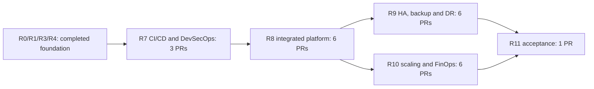

# DevOps lab v2 roadmap: complete learning and operations scope

Status as of 2026-10-18, following Bruno's explicit request to complete the technology list
(DEC-13). **Construction delivered in 22 PRs (R7–R11).** The 21 implementation PRs merged with
green CI; R11 records acceptance in this hub. R0, R1, R3 and R4 preserve the earlier foundation.
v2 remains `not run in the cloud (v2)`.

This is the single source of scope, sequence, acceptance and evidence. The
[scope audit](docs/SCOPE_AUDIT_2026-10-16.md) preserves the snapshot before construction.
The [acceptance matrix](docs/ACCEPTANCE.md), [curriculum](docs/CURRICULUM.md) and PRs below describe
the current implementation. Adding a capability to a plan does not deliver it.

## 1. What complete means

A fork owner should be able to learn and reproduce the capabilities below using the same
React + Node.js + PostgreSQL app in all three pairs, with IaC, exercises, diagnosis, costs and
cleanup. These are three deployments of the same application; three different products are
outside the family parity rule.

1. **Construction:** Terraform, manifests, images, workflows, contracts, runbooks and lessons cover
   EKS/AKS/GKE Autopilot, applications, networking/TLS/DNS/WAF, identity, security, observability,
   GitOps, HA, backup/restore, DR, Chaos and FinOps. Installing a technology without integration
   and an exercise does not close its item.
2. **Reproducible Docker/CI evidence:** application tests, policies, renders, mocked Terraform
   providers and real kind/PostgreSQL exercises validate portable behavior. The pipeline must
   also reject unsafe or incomplete configuration. Heavy runs, including SonarQube, DR and load,
   belong in GitHub Actions; they do not run on Bruno's machine.
3. **Code prepared for three clouds:** every capability has provider implementation, contract,
   IAM, costs, quota/prerequisites and operation/destruction steps. Autopilot limitations require
   a supported path or an explicit alternative; a statement that something is unsupported does
   not deliver mesh, DR or observability.
4. **Separate cloud validation:** Docker does not run EKS, AKS, GKE, RDS, Cloud SQL or real IAM.
   The first run in an operator's account may reveal fixes. Public certificates, external Slack
   delivery, managed failover, billed costs and 24/7 operation need an authorized cloud run before
   receiving cloud evidence. Until then: `not run in the cloud (v2)`.
5. **Usable forks:** exercise documentation, operator-owned credentials, explicit cost profiles,
   reproducible gates without mandatory commercial subscriptions, failure recovery and teardown
   with leftover checks. The fork owner supplies the domain, webhook and cloud accounts.

Economical defaults remain. Full platform, HA and DR are explicit choices with hourly/per-run
estimates and retention policies. Budgets alert; they do not automatically cap spending.
“Production”, “24/7”, “zero downtime” and “RPO/RTO” must identify the measured scenario.

### Changes since the previous closure

DEC-11 removed DR, FinOps, cloud HTTPS, SonarQube, advanced traffic management and other items.
The request of 2026-10-16 reopened them. The previous ten PRs remain merged and prove that round's
deliveries; they do not prove the expanded list. History is preserved.

This scope implements the named list in this file. Additional alternative tools, new products,
commercial support and a permanently hosted service require a new scope decision; “etc.” does
not implicitly add them.

## 2. Current state (2026-10-18)

| Area | Construction and evidence | Execution limit |
|---|---|---|
| EKS, AKS and GKE Autopilot | Terraform with economical/HA/DR profiles; mocks; real kind in CI; capacity/SLO/cost e2e | managed control planes and node scaling have no cloud run |
| React + Node.js + PostgreSQL | same app in three DX; digest releases, changed content, migration and rollback exercised | no deployment in a real account |
| CI/CD and security | real SonarQube/gate, CodeQL, Trivy, gitleaks, ZAP, coverage, artifacts and negative fixtures | cloud publication uses the fork's own identities/registry |
| Networking, TLS, WAF and IAM | DNS/TLS, private networks, federation, boundaries and policies as code; HTTPS on kind | real WAF engines, public issuance and IAM denials need cloud validation |
| Observability and OTel | integrated full app, PVC/retention, correlated signals, alerts and native exporters | external Slack, managed ingestion and 24/7 operation unexecuted |
| Mesh, policies and Chaos | L7 traffic, mTLS/identities, admission, scanning and hypotheses exercised; managed Autopilot path | provider-dependent cloud surfaces; Autopilot excludes incompatible privileged daemons |
| Data, HA, backup and DR | HA/PITR in all three; physical/WAL backup, PVC/checksum, independent A/B, fencing and failback in CI | managed-service failover/DR unexecuted |
| FinOps | OpenCost/showback, regional prices, budget/expiry, VPA Off and load verified in R10 CI | estimates are not invoices; local tests do not prove Spot savings |
| Cloud operations | validation and cleanup procedure per pair | operator-owned accounts/budget/domain; no real v2 run |

The acceptance matrix gives paths and limits. Installing charts does not automatically prove
that an app is monitored, protected by the mesh or recoverable.

## 3. Execution and tracking

Each item has `Status`, `Repos`, `Origin`, `Dependencies`, `Cost`, `Deliverables`, `Acceptance`
and, when `done`, `Evidence` with merged PRs. The harness validates format, dependencies and the
overview; `family-evidence` checks merges.

| Status | Meaning |
|---|---|
| `done` | merged delivery with green CI, within its acceptance limits |
| `in progress` | implementation/PR underway or only some repositories merged |
| `pending` | accepted scope, not implemented yet |
| `blocked` | depends on an identified external condition |
| `proposal` | suggestion not yet approved by Bruno |

Rules:

1. AWS is the reference; port a capability to other pairs in the same round with provider-required
   adaptations. The app remains the same across three DX repositories.
2. One cohesive PR per repository per round. Merge TX before DX; DX pins the merged TX commit in
   `deploy/local/tx0Nv2.ref`. Contract changes require a version bump and coordinated PRs.
3. Each PR includes implementation, relevant tests, lesson/exercise, runbook, costs and changelog.
   There is no PR per tool. Split a delivery that cannot be reviewed reasonably and update the
   estimate; never omit tests or mix unrelated work to meet a count.
4. Gates remain blocking and dependencies pinned. No `continue-on-error`, swallowed errors,
   unexplained scanner ignores or claims stronger than evidence.
5. Construction uses Docker/CI and offline IaC validation. Cloud deployment, failover and spending
   require specific authorization for the run and reviewed cost/plan.
6. The hub maintains this plan and a final acceptance PR. Technical lessons/evidence accompany
   pair PRs; intermediate documentation can be grouped without a PR for every checkbox.
7. Preserve history: completed milestones are not counted again as missing construction.
   New stages close concrete gaps; real cloud validation retains a separate state.

## 4. Overview

| ID | Item | Status |
|---|---|---|
| R0.1 | Six public v2 repositories with harness, CI and guardrails | `done` |
| R0.2 | Same app in all three pairs (parity rule) | `done` |
| R0.3 | Local lab with the full v1 platform | `done` |
| R0.4 | Local lab as a merge gate | `done` |
| R0.5 | Ready for forks | `done` |
| R0.6 | Family hub (this repository) | `done` |
| R0.7 | Scripts restricted to lab resources (fork safety) | `done` |
| R1.1 | Traces in the local platform | `done` |
| R1.2 | Slack alerts | `done` |
| R1.3 | Chaos hypotheses: network latency and stress | `done` |
| R1.4 | App traces and contract v2 | `done` |
| R1.5 | Rollout without downtime and API-to-database latency | `done` |
| R1.6 | Cloud trace exporters as code | `done` |
| R1.7 | Debt: cloud Collector chart SHA256 in tx01v2 | `done` |
| R1.8 | Debt: smaller e2e-platform profile below 8 GB | `done` |
| R1.9 | Debt: unstable Trivy Operator server installation | `done` |
| R1.10 | Debt: ESO webhook timeout in tx03v2 local lab | `done` |
| R3.10 | Permission boundary on the AWS apply role | `done` |
| R3.13 | Azure/GCP leftovers.sh counts only lab resources | `done` |
| R3.14 | Destroy always reaches completion | `done` |
| R3.15 | OIDC/WIF pinned to immutable IDs and main | `done` |
| R3.16 | Narrower CI roles outside dedicated accounts | `done` |
| R3.17 | Public logs without identifiers and smoke without plaintext tokens | `done` |
| R3.18 | Side effects on fork owners' machines | `done` |
| R4.1 | Cloud platform core/full profiles | `done` |
| R4.2 | ADR: in-cluster or managed observability per cloud | `done` |
| R4.3 | Istio ambient in the three clouds | `done` |
| R4.4 | Cloud Argo CD and GitOps app deployment | `done` |
| R4.5 | Velero with each cloud's object storage | `done` |
| R4.6 | Cloud Gatekeeper, Trivy Operator and Chaos Mesh | `done` |
| R4.7 | Full profile sizing and costs | `done` |
| R4.8 | Fork to own cloud, end to end | `done` |
| R7.1 | SonarQube, SAST, quality and security gates | `done` |
| R7.2 | Promote the approved artifact with migration/rollback | `done` |
| R8.1 | Secure edge, identity and consistent fork path | `done` |
| R8.2 | Mesh and advanced traffic in three Kubernetes platforms | `done` |
| R8.3 | App observability, retention and managed integrations | `done` |
| R8.4 | Integrated runtime security and Chaos Engineering | `done` |
| R9.1 | Database HA and verifiable data recovery | `done` |
| R9.2 | Cross-region DR, failover and failback | `done` |
| R10.1 | Demand autoscaling, load and Spot capacity | `done` |
| R10.2 | OpenCost FinOps, showback and rightsizing | `done` |
| R11.1 | Scope matrix, lessons and final evidence | `done` |
| S.1 | Node.js 26 LTS in apps | `pending` |
| S.2 | Kubernetes 1.37 and aligned kubectl | `pending` |
| S.3 | Istio 1.31 to 1.33 | `pending` |
| S.4 | Trivy exceptions expiring 2027-04-30 | `pending` |
| S.5 | nginx 1.32 in apps | `pending` |
| S.6 | Amazon Linux 2023 on EKS nodes | `pending` |
| S.7 | kubeconform CRD schemas | `pending` |
| S.8 | “contract v1” references describing version 2 | `done` |
| S.9 | First joint quarterly family review | `pending` |

## 5. Delivery plan and PR count

**Delivered: 22 construction PRs, `3 + 6 + 6 + 6 + 1`.** The 21 pair PRs merged, and this
hub's R11 PR closes the count. **Zero DEC-13 construction PRs remain.** The scope revision and
additional corrections recorded in history are not counted again among those 22.

| Round | Cohesive delivery | Repositories | Delivered PRs |
|---|---|---|---:|
| R7 | DevSecOps/releases: SonarQube/SAST/gates, digest artifacts, migration/rollback | dx01v2, dx02v2, dx03v2 | 3 |
| R8 | Integrated cloud platform: TLS/DNS/WAF/IAM, mesh, durable observability, policies/scanning/Chaos | TX + DX per cloud | 6 |
| R9 | Data continuity: HA, backup/PITR/restore, cross-region DR, failover/failback | TX + DX per cloud | 6 |
| R10 | FinOps/capacity: autoscaling/Spot, OpenCost/showback, VPA/rightsizing/load | TX + DX per cloud | 6 |
| R11 | Final acceptance, curriculum and complete-scope evidence matrix | tx00v2 | 1 |
| **Construction total** | | | **22** |

R8 combined platform items into one contract per pair; R9 combined data protection/recovery.
Lessons and runbooks accompany implementations in all six repositories and are consolidated
in the curriculum and acceptance matrix.

Round order: tx01v2 → dx01v2, tx02v2 → dx02v2, tx03v2 → dx03v2; independent pairs may advance in
parallel. R7 starts in DX; R8 integrates the release chain. HA/DR and FinOps have separate jobs
to avoid overloading the basic lab exercise.

Real validation in three clouds is a later operational stage with operator-owned accounts, domain,
quotas, webhook and budget. Running it does not itself require a PR. Any discovered fixes become
additional work with evidence; their count cannot be promised in advance. The S maintenance
calendar remains separate from the 22 construction deliveries.

## R7. DevSecOps and release delivery

Three PRs, one per DX, covering both items below.

### R7.1 SonarQube, SAST, quality and security gates

- Status: `done`
- Repos: dx01v2, dx02v2, dx03v2
- Origin: Bruno's request of 2026-10-16, DEC-1 and DEC-13
- Dependencies: R0.4, R1.4
- Cost: no mandatory commercial subscription; SonarQube and DAST in isolated Actions jobs;
  documented runner resources/limits, without running the suite on Bruno's machine.
- Deliverables:
  - Reproducible SonarQube Community Build with database, pinned scanner and coverage analysis;
    a real quality gate blocks promotion. Explain Community main-branch analysis without relying
    on commercial PR decoration or multibranch features.
  - PR SAST (CodeQL where the public fork's license permits), Trivy, gitleaks, coverage and OWASP
    ZAP against the local app. Safe fork-PR execution without exposing secrets.
  - Image SBOM, provenance and keyless signatures verified before promotion. Pin the expected
    identity/issuer rather than accepting any valid signature.
  - A lesson with a quality defect, vulnerability and fictitious secret; redacted reports, fix
    criteria and expiring exceptions, preserving existing gates.
- Acceptance:
  - CI performs real Sonar analysis and reads the gate result; negative fixtures prove that
    quality, SAST, DAST and missing/wrong artifact identity/signatures block promotion.
  - A fork without paid services can run the lessons; scanner unavailability cannot become
    approval. Gates work before first publication without production secrets in PRs.
- Evidence: [dx01v2#17](https://github.com/maringelix/dx01v2/pull/17), [dx02v2#12](https://github.com/maringelix/dx02v2/pull/12), [dx03v2#14](https://github.com/maringelix/dx03v2/pull/14)

### R7.2 Promote the approved artifact with migration and rollback

- Status: `done`
- Repos: dx01v2, dx02v2, dx03v2
- Origin: deployment audit and zero-downtime CI/CD request, DEC-13
- Dependencies: R7.1, R4.4
- Cost: build/test/load Actions jobs; artifact and registry retention described in runbooks.
- Deliverables:
  - Build once; ECR, ACR and Artifact Registry receive the approved digest for the exact commit.
    Manual workflows verify that commit's gates/provenance without rebuilding at deployment.
  - Release two versions with different content, compatible expand/contract migrations,
    readiness, PDB, rollout, GitOps promotion and rollback to a known digest.
  - Exercises with a rejected image, failed migration and unready version; distinguish app
    rollback from data recovery and document irreversible migration limits.
- Acceptance:
  - Continuous kind/CI requests during a real version change prove the test's availability
    objective, new content serving and restoration of the previous version after induced failure.
  - No deployment path bypasses gates, substitutes digests or promotes a different SHA. Validate
    the release path for all three clouds; real execution remains separate.
- Evidence: [dx01v2#17](https://github.com/maringelix/dx01v2/pull/17), [dx02v2#12](https://github.com/maringelix/dx02v2/pull/12), [dx03v2#14](https://github.com/maringelix/dx03v2/pull/14)

## R8. Complete cloud platform integrated with the app

Six PRs, one per TX/DX. Each pair jointly closes all four items; provider limitations require
supported implementation and an explicit equivalent exercise.

### R8.1 Secure edge, identity and consistent fork path

- Status: `done`
- Repos: tx01v2, dx01v2, tx02v2, dx02v2, tx03v2, dx03v2
- Origin: networking/WAF/SSL/DNS/least-privilege request and fork gaps, DEC-13
- Dependencies: R7.2, R3.16, R4.8
- Cost: provider DNS, domain, managed certificates, LB, WAF, NAT and IPs in `docs/COSTS.md`;
  economical defaults without real domains or accounts embedded in repositories.
- Deliverables:
  - DNS and HTTPS as IaC/contracts in all three clouds, automatic renewal, HTTP redirect and
    invalid-configuration tests. Exercise cert-manager/ACME with test ACME on Docker; document
    the boundary wherever the load balancer requires a provider certificate.
  - Public/private subnets, egress, Ingress/Gateway/LB, WAF rules and denial probes; private
    databases, app/database TLS, NetworkPolicies and secrets through workload identity.
  - Review bootstrap, plan, apply, runtime and backup IAM/RBAC; narrow broad permissions where
    viable, test denials and justify residual privilege within the dedicated lab scope.
  - Separate consistent fork paths for core and full; do not require GitOps without Argo CD.
    Inputs, contracts, outputs, scripts and workflows agree.
- Acceptance:
  - CI validates provider DNS/certificates/routes with mocks/renders and exercises local
    ACME/renewal, isolation and WAF denial without claiming real public issuance or IAM evidence.
  - Offline rehearsal from fresh fork configuration covers core/full and missing prerequisites;
    checks validate policies and scripts reject non-lab contexts/targets. Effective IAM denials
    await cloud validation.
- Evidence: [tx01v2#16](https://github.com/maringelix/tx01v2/pull/16), [dx01v2#18](https://github.com/maringelix/dx01v2/pull/18), [tx02v2#14](https://github.com/maringelix/tx02v2/pull/14), [dx02v2#13](https://github.com/maringelix/dx02v2/pull/13), [tx03v2#15](https://github.com/maringelix/tx03v2/pull/15), [dx03v2#15](https://github.com/maringelix/dx03v2/pull/15)

### R8.2 Mesh and advanced traffic management in three Kubernetes platforms

- Status: `done`
- Repos: tx01v2, dx01v2, tx02v2, dx02v2, tx03v2, dx03v2
- Origin: service mesh and advanced traffic request in all three clouds, DEC-13
- Dependencies: R8.1, R4.3
- Cost: dataplane/waypoints, capacity and managed service estimates per profile; use a supported
  GKE Autopilot path without incompatible privileged daemons.
- Deliverables:
  - STRICT internal mTLS, identity authorization and egress policies integrated with all three
    apps. External load balancers/gateways use origin TLS or a narrow justified edge exception,
    preserving isolation and testing ingress.
  - Canary splitting, timeouts, bounded retries and circuit breaking/outlier detection with an
    L7 dataplane; enable a waypoint when ambient requires one.
  - Managed Cloud Service Mesh IaC/installation for Autopilot or an officially supported
    equivalent, recording versions, prerequisites and learning differences.
- Acceptance:
  - CI measures traffic distribution across different versions, bounds retry amplification,
    rejects unauthorized identities and observes failure isolation; rendering routes is insufficient.
  - Manifests/contract tests cover all targets; local evidence states managed-service limits and
    runbooks cover mesh diagnosis/teardown.
- Evidence: [tx01v2#16](https://github.com/maringelix/tx01v2/pull/16), [dx01v2#18](https://github.com/maringelix/dx01v2/pull/18), [tx02v2#14](https://github.com/maringelix/tx02v2/pull/14), [dx02v2#13](https://github.com/maringelix/dx02v2/pull/13), [tx03v2#15](https://github.com/maringelix/tx03v2/pull/15), [dx03v2#15](https://github.com/maringelix/dx03v2/pull/15)

### R8.3 App observability, retention and managed integrations

- Status: `done`
- Repos: tx01v2, dx01v2, tx02v2, dx02v2, tx03v2, dx03v2
- Origin: complete observability, OpenTelemetry, Cloud Monitoring and Slack request, DEC-13
- Dependencies: R8.1, R1.6, R4.2
- Cost: explicit volume/object-storage, retention, ingestion and egress costs; economical limits
  avoid unnecessary duplication of in-cluster and managed signals.
- Deliverables:
  - Cloud-full ServiceMonitor, PrometheusRule, dashboards and app signals; OpenTelemetry
    correlates metrics/logs/traces using exemplars and trace_id.
  - Prometheus/Grafana/Alertmanager/Loki/Tempo persistence, retention and recovery; native
    exporters, dashboards and alert policies, including Google Cloud Monitoring.
  - Parameterized Slack alerts, external secret, grouping/silencing and incident runbook;
    absent webhooks/null receivers visibly mean an unconfigured integration.
  - SLIs/SLOs, error budgets, burn-rate alerts and synthetic monitoring.
- Acceptance:
  - CI induces app error/latency and proves metrics, traces, correlated logs and sink alerts;
    component restarts preserve expected data within the declared retention window.
  - Policies/IAM/native exporters are checked offline; external Slack, real provider ingestion
    and 24/7 availability receive evidence only after real execution.
- Evidence: [tx01v2#16](https://github.com/maringelix/tx01v2/pull/16), [dx01v2#18](https://github.com/maringelix/dx01v2/pull/18), [tx02v2#14](https://github.com/maringelix/tx02v2/pull/14), [dx02v2#13](https://github.com/maringelix/dx02v2/pull/13), [tx03v2#15](https://github.com/maringelix/tx03v2/pull/15), [dx03v2#15](https://github.com/maringelix/dx03v2/pull/15)

### R8.4 Integrated runtime security and Chaos Engineering

- Status: `done`
- Repos: tx01v2, dx01v2, tx02v2, dx02v2, tx03v2, dx03v2
- Origin: OPA, continuous scanning and Chaos in three clouds, DEC-13
- Dependencies: R8.1, R8.2, R8.3, R4.6
- Cost: bounded scanner/experiment requests, limits, concurrency and duration; exercises include
  interruption, metrics and replacement-capacity costs.
- Deliverables:
  - Gatekeeper deny policies with positive/negative cases, least privilege, hardening and
    isolation. Admission also verifies artifact signature/issuer/identity through a supported
    provider mechanism, including GCP Binary Authorization or a documented equivalent.
  - Trivy Operator scans private ECR/ACR/Artifact Registry images using identity or short-lived
    credentials; a missing report is not a clean image.
  - Hypotheses, steady state, abort and recovery for pod, latency, CPU/memory and local node loss.
    The cloud matrix identifies supported experiments per provider.
  - Supported Autopilot alternatives where privileged Chaos Daemon is unavailable; no promise of
    user-controlled managed-node shutdown without support.
- Acceptance:
  - CI rejects unsafe workloads and wrong/missing artifact signatures, detects a simulated
    vulnerable private image, executes hypotheses and recovers the app. Wrong contexts/scopes
    and non-lab targets are rejected; managed admission policies are checked offline.
  - Scanner access failures remain failures. Manifests/IAM and experiment limits pass offline
    checks for all three targets; cloud execution remains unvalidated.
- Evidence: [tx01v2#16](https://github.com/maringelix/tx01v2/pull/16), [dx01v2#18](https://github.com/maringelix/dx01v2/pull/18), [tx02v2#14](https://github.com/maringelix/tx02v2/pull/14), [dx02v2#13](https://github.com/maringelix/dx02v2/pull/13), [tx03v2#15](https://github.com/maringelix/tx03v2/pull/15), [dx03v2#15](https://github.com/maringelix/dx03v2/pull/15)

## R9. High availability, backup and Disaster Recovery

Six PRs, one per TX/DX. Kubernetes object, volume and database backups have separate evidence.
A namespace in the same cluster does not replace a second region.

### R9.1 Database HA and verifiable data recovery

- Status: `done`
- Repos: tx01v2, dx01v2, tx02v2, dx02v2, tx03v2, dx03v2
- Origin: PostgreSQL HA, backups and data continuity request, DEC-13
- Dependencies: R8.3, R4.5, R7.2
- Cost: opt-in RDS multi-AZ, Flexible Server HA and regional Cloud SQL; include instances,
  storage, WAL/backups, retention and restore in `docs/COSTS.md`.
- Deliverables:
  - Supported HA choices with region/SKU validation and economical defaults; parameterized,
    tested automatic backup, PITR, retention and deletion protection.
  - Real local PostgreSQL backup and WAL/PITR: write records, destroy/corrupt the target,
    restore a known point, verify content/integrity and reconnect the app.
  - Velero objects/volumes where applicable, CSI/data mover and permissions; managed databases
    use native backup rather than the earlier ConfigMap restore exercise.
  - Isolated restore, endpoint/secret switch, HA failover and switch rollback runbooks.
- Acceptance:
  - CI proves record recovery and volume checksum recovery where the scenario uses volumes,
    rejecting incomplete/corrupt backups. Object restore alone is insufficient.
  - `terraform test` checks provider HA/PITR/retention/denials. Kind is not managed multi-AZ
    failover evidence. Local RPO/RTO uses timestamps and observed loss.
- Evidence: [tx01v2#17](https://github.com/maringelix/tx01v2/pull/17), [dx01v2#19](https://github.com/maringelix/dx01v2/pull/19), [tx02v2#17](https://github.com/maringelix/tx02v2/pull/17), [dx02v2#14](https://github.com/maringelix/dx02v2/pull/14), [tx03v2#16](https://github.com/maringelix/tx03v2/pull/16), [dx03v2#16](https://github.com/maringelix/dx03v2/pull/16)

### R9.2 Cross-region DR with failover and failback

- Status: `done`
- Repos: tx01v2, dx01v2, tx02v2, dx02v2, tx03v2, dx03v2
- Origin: explicit multi-region Disaster Recovery request, DEC-13
- Dependencies: R9.1, R8.1, R8.2
- Cost: opt-in second region; budget standby compute, replicas/copies, egress, DNS, secrets,
  registry, backups and retention. Explain warm/pilot-light trade-offs.
- Deliverables:
  - Primary/secondary IaC in different regions per cloud; database replication/copy, backups,
    artifacts, secrets/configuration and recoverable versioned remote state.
  - Independent local A/B environments simulating complete primary loss; promotion, split-brain
    fencing, routing, data verification and controlled return to primary.
  - Failover/failback runbooks with prerequisites, human approval, acceptable loss,
    reconciliation/teardown; monitor backup age/lag and actual recovery capability.
- Acceptance:
  - CI loses A, recovers in B, fails back, measures RPO/RTO against scenario goals, checks records
    and refuses promotion without guaranteed single-writer ownership.
  - IaC renders/tests prove two regions with independent dependencies in each cloud; real
    failover, latency/egress and managed-service RPO/RTO await cloud validation.
- Evidence: [tx01v2#17](https://github.com/maringelix/tx01v2/pull/17), [dx01v2#19](https://github.com/maringelix/dx01v2/pull/19), [tx02v2#17](https://github.com/maringelix/tx02v2/pull/17), [dx02v2#14](https://github.com/maringelix/dx02v2/pull/14), [tx03v2#16](https://github.com/maringelix/tx03v2/pull/16), [dx03v2#16](https://github.com/maringelix/dx03v2/pull/16)

## R10. FinOps, capacity and scaling

Six PRs, one per TX/DX, covering both items below.

### R10.1 Demand autoscaling, load and Spot capacity

- Status: `done`
- Repos: tx01v2, dx01v2, tx02v2, dx02v2, tx03v2, dx03v2
- Origin: EKS autoscaling, Autopilot/Spot and optimization request, DEC-13
- Dependencies: R8.3, R8.4
- Cost: pod/node limits, load duration/cancellation, baseline on-demand capacity and maximum
  estimated scenario cost. Budgets remain alerts rather than billing caps.
- Deliverables:
  - EKS node scaling controller (Cluster Autoscaler or Karpenter), beyond node-group min/max;
    AKS autoscaler and Autopilot requests/limits/conditions consistent with HPA.
  - Provider-specific Spot/tolerations/affinity and fallback, preserving critical components;
    interruption, drain, PDB and rescheduling without assuming available Spot capacity.
  - Reproducible load with SLO, HPA up/down, stabilization, quotas and database saturation;
    distinguish pod, node and managed-service capacity scaling.
- Acceptance:
  - CI exercises local HPA/load, rescheduling and capacity loss with metrics and explicit
    pass/fail criteria. IaC/IAM tests check provider controllers/profiles.
  - Real managed-node changes and Spot savings need cloud evidence; static `scaling_config`
    alone does not prove EKS autoscaling.
- Evidence: [tx01v2#18](https://github.com/maringelix/tx01v2/pull/18), [dx01v2#20](https://github.com/maringelix/dx01v2/pull/20), [tx02v2#18](https://github.com/maringelix/tx02v2/pull/18), [dx02v2#15](https://github.com/maringelix/dx02v2/pull/15), [tx03v2#17](https://github.com/maringelix/tx03v2/pull/17), [dx03v2#17](https://github.com/maringelix/dx03v2/pull/17)

### R10.2 OpenCost FinOps, showback and rightsizing

- Status: `done`
- Repos: tx01v2, dx01v2, tx02v2, dx02v2, tx03v2, dx03v2
- Origin: FinOps and advanced optimization request, DEC-13
- Dependencies: R10.1
- Cost: opt-in cost stack; provider source, currency, region, date and estimate limits;
  include external services, storage, backup/DR, NAT/LB/WAF and egress.
- Deliverables:
  - OpenCost metrics/dashboards by namespace/app/environment with provider pricing; showback,
    labels/tags, idle/shared costs and future reconciliation with actual bills.
  - VPA initially in recommendation mode, requests/limits based on load and before/after
    comparisons; avoid automatic VPA/HPA conflict on the same resource.
  - PR/plan estimates, budgets/alerts, temporary-environment expiration, safe teardown,
    leftovers inventory and per-run cost reports.
- Acceptance:
  - CI generates allocations from deterministic data, enforces mandatory labels and rejects an
    expensive scenario against the configured limit; rightsizing preserves SLO under load.
  - Dashboards distinguish estimates from invoices and include non-pod costs. Cleanup tests
    reject unrelated resources; OpenCost and budget alerts are not real financial caps.
- Evidence: [tx01v2#18](https://github.com/maringelix/tx01v2/pull/18), [dx01v2#20](https://github.com/maringelix/dx01v2/pull/20), [tx02v2#18](https://github.com/maringelix/tx02v2/pull/18), [dx02v2#15](https://github.com/maringelix/dx02v2/pull/15), [tx03v2#17](https://github.com/maringelix/tx03v2/pull/17), [dx03v2#17](https://github.com/maringelix/dx03v2/pull/17)

## R11. Complete lab acceptance and fork curriculum

### R11.1 Scope matrix, lessons and final evidence

- Status: `done`
- Repos: tx00v2
- Origin: complete lab for fork owners, DEC-13
- Dependencies: R7.1, R7.2, R8.1, R8.2, R8.3, R8.4, R9.1, R9.2, R10.1, R10.2
- Cost: no cloud in the hub; catalog separates local/Actions costs and core/full/HA/DR profiles.
- Deliverables:
  - Technology curriculum with prerequisites, architecture, objective, commands, intentional
    failure, success criteria, diagnosis, recovery, costs and cleanup; links to all six labs.
  - Requirement × cloud × implementation × test × limit × PR/evidence matrix; family harness
    checks the same app, compatible versions, contracts and fork documentation.
  - Security/quality/operations checklist and future cloud validation procedure; README and
    publishing describe CI evidence without claiming production or 24/7 operations.
- Acceptance:
  - Every named requirement has implementation, merged green-CI PRs, a reproducible exercise
    and explicit handling of provider differences.
  - Fresh-configuration fork rehearsal and full CI pass without maintainer secrets; technical
    gaps are not hidden as documentation. Real validation keeps its own state with operator
    accounts/budget/domain; future fixes are recorded.
- Evidence: [dx01v2#17](https://github.com/maringelix/dx01v2/pull/17), [dx02v2#12](https://github.com/maringelix/dx02v2/pull/12), [dx03v2#14](https://github.com/maringelix/dx03v2/pull/14), [tx01v2#16](https://github.com/maringelix/tx01v2/pull/16), [dx01v2#18](https://github.com/maringelix/dx01v2/pull/18), [tx02v2#14](https://github.com/maringelix/tx02v2/pull/14), [dx02v2#13](https://github.com/maringelix/dx02v2/pull/13), [tx03v2#15](https://github.com/maringelix/tx03v2/pull/15), [dx03v2#15](https://github.com/maringelix/dx03v2/pull/15), [tx01v2#17](https://github.com/maringelix/tx01v2/pull/17), [dx01v2#19](https://github.com/maringelix/dx01v2/pull/19), [tx02v2#17](https://github.com/maringelix/tx02v2/pull/17), [dx02v2#14](https://github.com/maringelix/dx02v2/pull/14), [tx03v2#16](https://github.com/maringelix/tx03v2/pull/16), [dx03v2#16](https://github.com/maringelix/dx03v2/pull/16), [tx01v2#18](https://github.com/maringelix/tx01v2/pull/18), [dx01v2#20](https://github.com/maringelix/dx01v2/pull/20), [tx02v2#18](https://github.com/maringelix/tx02v2/pull/18), [dx02v2#15](https://github.com/maringelix/dx02v2/pull/15), [tx03v2#17](https://github.com/maringelix/tx03v2/pull/17), [dx03v2#17](https://github.com/maringelix/dx03v2/pull/17); [curriculum](docs/CURRICULUM.md), [acceptance matrix](docs/ACCEPTANCE.md) and ledger checked by delivery/family-evidence. The hub closure is the PR integrating these materials.

## Earlier milestones (R0 to R4)

The following items preserve historical acceptance and PRs. The expanded scope is R7 to R11;
earlier statuses do not hide limitations identified by the audit.

## R0. v2 foundation

### R0.1 Six public v2 repositories with harness, CI and guardrails

- Status: `done`
- Repos: tx01v2, dx01v2, tx02v2, dx02v2, tx03v2, dx03v2
- Origin: v2 debt (rebuilding v1 with local evidence and accurate labels)
- Dependencies: none
- Cost: none (public-repository GitHub Actions)
- Deliverables:
  - `scripts/harness.sh` with static/test stages and DX build/kind e2e; tools pinned by
    version/SHA256 in tools/, actions by 40-character SHA, images by digest.
  - CI = harness (ci.yml calls make), HARNESS_STRICT=1, weekly CI and monthly Dependabot.
  - Ruleset as code and repo-guardrails.sh, applied/read back with gh api on 2026-10-14.
  - Originally Brazilian Portuguese docs for architecture, contract, runbook, costs, guardrails,
    harness, maintenance, publishing and v1 lessons; standardized to English in the later language round.
- Acceptance:
  - Green CI across six repositories; verified-in-CI labels only after the first successful run.
- Evidence: [tx01v2#1](https://github.com/maringelix/tx01v2/pull/1), [dx01v2#3](https://github.com/maringelix/dx01v2/pull/3), [tx02v2#1](https://github.com/maringelix/tx02v2/pull/1), [dx02v2#1](https://github.com/maringelix/dx02v2/pull/1), [tx03v2#1](https://github.com/maringelix/tx03v2/pull/1), [dx03v2#3](https://github.com/maringelix/dx03v2/pull/3), [tx01v2#2](https://github.com/maringelix/tx01v2/pull/2), [tx01v2#3](https://github.com/maringelix/tx01v2/pull/3), [tx02v2#2](https://github.com/maringelix/tx02v2/pull/2), [tx03v2#2](https://github.com/maringelix/tx03v2/pull/2)

### R0.2 Same app in all three pairs (parity rule)

- Status: `done`
- Repos: dx01v2, dx02v2, dx03v2
- Origin: v2 debt (v1 had different apps: Node 20/PostgreSQL, SQL Server, TypeScript/Tailwind)
- Dependencies: R0.1
- Cost: none
- Deliverables:
  - dx01v2 app (commit 22e69c4: Express 5/TypeScript, React 19 on nginx-unprivileged,
    PostgreSQL 17) in all app repositories; only the deployment target changes.
  - Parity rule in DX AGENTS and routine in docs/MAINTENANCE.md.
  - AGC and Google load-balancer X-Forwarded-For cases ported to all three.
- Acceptance:
  - family-app checks equal dependencies and api/src/web/src after normalizing names/comments.
- Evidence: [dx01v2#4](https://github.com/maringelix/dx01v2/pull/4), [dx01v2#5](https://github.com/maringelix/dx01v2/pull/5), [dx02v2#2](https://github.com/maringelix/dx02v2/pull/2), [dx03v2#4](https://github.com/maringelix/dx03v2/pull/4)

### R0.3 Local lab with the complete v1 platform

- Status: `done`
- Repos: tx01v2, dx01v2, tx02v2, dx02v2, tx03v2, dx03v2
- Origin: implemented v1 (the earlier platform existed only in clouds, installed by workflows)
- Dependencies: R0.1
- Cost: free local execution; 8 GB Docker memory for full, 3 GB for core
- Deliverables:
  - terraform/envs/local with Docker provider: kind and local registry, TLS-only PostgreSQL 17,
    object storage, load balancer and GitHub substitute (Git server).
  - platform/local core/observability/operations/full profiles, lab-system/lab-contract,
    check.sh probes and uninstall.sh without leftovers.
  - DX local-platform overlay, scripts/deploy-local.sh (Argo CD GitOps) and scripts/e2e-platform.sh.
- Acceptance:
  - TX make e2e and DX make e2e-platform pass in CI, including destroy and leftover checks.
- Evidence: [tx01v2#5](https://github.com/maringelix/tx01v2/pull/5), [tx01v2#6](https://github.com/maringelix/tx01v2/pull/6), [tx02v2#3](https://github.com/maringelix/tx02v2/pull/3), [tx02v2#4](https://github.com/maringelix/tx02v2/pull/4), [tx03v2#3](https://github.com/maringelix/tx03v2/pull/3), [dx01v2#6](https://github.com/maringelix/dx01v2/pull/6), [dx02v2#3](https://github.com/maringelix/dx02v2/pull/3), [dx03v2#5](https://github.com/maringelix/dx03v2/pull/5)

### R0.4 Local lab as a merge gate

- Status: `done`
- Repos: tx01v2, dx01v2, tx02v2, dx02v2, tx03v2, dx03v2
- Origin: v2 debt
- Dependencies: R0.3
- Cost: roughly 30–50 runner minutes per PR (public-repository allowance at the recorded delivery)
- Deliverables:
  - TX e2e and DX e2e-platform required by rulesets applied through repo-guardrails.sh.
- Acceptance:
  - gh api readback lists the jobs; family-identical enforces equal rulesets within each role.
- Evidence: [tx01v2#7](https://github.com/maringelix/tx01v2/pull/7), [tx02v2#5](https://github.com/maringelix/tx02v2/pull/5), [tx03v2#4](https://github.com/maringelix/tx03v2/pull/4), [dx01v2#7](https://github.com/maringelix/dx01v2/pull/7), [dx02v2#4](https://github.com/maringelix/dx02v2/pull/4), [dx03v2#6](https://github.com/maringelix/dx03v2/pull/6)

### R0.5 Ready for forks

- Status: `done`
- Repos: tx01v2, dx01v2, tx02v2, dx02v2, tx03v2, dx03v2
- Origin: v2 debt (Bruno's team learns by forking pairs)
- Dependencies: R0.1
- Cost: none
- Deliverables:
  - FORK.md in every repository: uncopied GitHub settings, local lab and own cloud accounts.
  - No default github_owner in bootstraps; repo-guardrails.sh enables Issues/fork-run approval
    and fails clearly until fork Actions are enabled.
  - DX e2e-platform clones the configured TX01V2_REPO, TX02V2_REPO or TX03V2_REPO URL.
- Acceptance:
  - Devcontainers checked with LOCAL_PROFILE=core make e2e on 2026-10-14; rehearsal using a
    second GitHub account was excluded under DEC-11.
- Evidence: [tx01v2#8](https://github.com/maringelix/tx01v2/pull/8), [tx02v2#6](https://github.com/maringelix/tx02v2/pull/6), [tx03v2#5](https://github.com/maringelix/tx03v2/pull/5), [dx01v2#8](https://github.com/maringelix/dx01v2/pull/8), [dx02v2#5](https://github.com/maringelix/dx02v2/pull/5), [dx03v2#7](https://github.com/maringelix/dx03v2/pull/7)

### R0.6 Family hub (this repository)

- Status: `done`
- Repos: tx00v2, tx01v2, dx01v2, tx02v2, dx02v2, tx03v2, dx03v2
- Origin: v2 proposal (v1 tx00 was a private audit tracker)
- Dependencies: R0.1
- Cost: none
- Deliverables:
  - This repository: reference README, roadmap, [guardrails](docs/GUARDRAILS.md),
    required static and cross-repository family stages, [history](docs/HISTORY.md).
  - tx00v2 entry in all six repositories' family tables.
- Acceptance:
  - Green static/family CI, applied/read-back ruleset; family-table originally found the hub
    in all 12 bilingual READMEs (now seven canonical English READMEs across the family).
- Evidence: [tx01v2#10](https://github.com/maringelix/tx01v2/pull/10), [dx01v2#10](https://github.com/maringelix/dx01v2/pull/10), [tx02v2#8](https://github.com/maringelix/tx02v2/pull/8), [tx03v2#6](https://github.com/maringelix/tx03v2/pull/6), [dx02v2#6](https://github.com/maringelix/dx02v2/pull/6), [dx03v2#8](https://github.com/maringelix/dx03v2/pull/8)

### R0.7 Scripts restricted to lab resources (fork safety)

- Status: `done`
- Repos: tx01v2, dx01v2, tx02v2, dx02v2, tx03v2, dx03v2
- Origin: fork safety audit of 2026-10-14: risks to fork owners' machines/accounts
- Dependencies: R0.5
- Cost: none
- Deliverables:
  - Cloud targets do not come from generic overrides (CLUSTER_NAME, RESOURCE_GROUP, LAB_*).
    They come from contracts and require the Project tag (AWS/Azure) or project label (GCP)
    before mutations through require_lab_cluster.
  - Temporary cloud kubeconfigs in scripts, dedicated files in outputs/runbooks; preserve
    ~/.kube/config and the operator's context. Azure kubelogin converts only that file.
  - platform/local and deploy-local.sh require kind-tx0Nv2-local via require_lab_context.
  - Destructive integration tests accept only database names ending _test, in helpers/harness;
    runbooks show a separate test database.
  - AWS leftovers counts only lab-tagged Elastic IPs; Azure PostgreSQL names include subscription
    suffixes to avoid global DNS collisions between forks.
  - TX policy-scripts (SEC-10/14/16), DX SEC-07/08/09 and family SEC-05.
- Acceptance:
  - Strict local verify and green six-repository CI (static/test/e2e, DX images/e2e-platform).
    Database guards accept dx01v2_test and reject dx01v2 before connecting, in harness and Vitest.
- Evidence: [tx01v2#11](https://github.com/maringelix/tx01v2/pull/11), [tx02v2#9](https://github.com/maringelix/tx02v2/pull/9), [tx03v2#8](https://github.com/maringelix/tx03v2/pull/8), [dx01v2#11](https://github.com/maringelix/dx01v2/pull/11), [dx02v2#7](https://github.com/maringelix/dx02v2/pull/7), [dx03v2#9](https://github.com/maringelix/dx03v2/pull/9)

## R1. Observability 2.0, alerts, Chaos and rollout without downtime

This round added missing v1 observability and its unstarted final OpenTelemetry milestone.
Local/cloud contracts became version 2 with the Collector OTLP endpoint.

### R1.1 Traces in the local platform

- Status: `done`
- Repos: tx01v2, tx02v2, tx03v2
- Origin: planned v1 Observability 2.0 (v1 had Application Insights and Istio Jaeger only)
- Dependencies: R0.3
- Cost: about 0.5 GB more local memory in observability
- Deliverables:
  - OpenTelemetry Collector chart 0.176.0, digest-pinned contrib image and
    grafana-community/tempo chart 3.1.0 in observability.
  - Istio Gateway spans through Telemetry API/W3C context and istiod extensionProviders.
  - spanmetrics connector with exemplars and 10-second ServiceMonitor (15-second exemplar flush).
  - Grafana datasources linking Tempo, Loki and Prometheus.
- Acceptance:
  - check_tracing proves OTLP traces in Tempo, Gateway span, spanmetrics exemplar and Grafana
    links; historical probe counts: 22 observability, 34 full.
- Evidence: [tx01v2#9](https://github.com/maringelix/tx01v2/pull/9), [tx02v2#7](https://github.com/maringelix/tx02v2/pull/7), [tx03v2#6](https://github.com/maringelix/tx03v2/pull/6)

### R1.2 Slack alerts

- Status: `done`
- Repos: tx01v2, tx02v2, tx03v2
- Origin: implemented v1 (Alertmanager Slack receivers in three clouds)
- Dependencies: R0.3
- Cost: none
- Deliverables:
  - Alertmanager Slack receiver reads an optional Secret; without it nothing leaves the cluster.
  - CI points the webhook at the local alert sink, which stores the payload.
- Acceptance:
  - check_slack receives the synthetic alert in Slack message format.
- Evidence: [tx01v2#9](https://github.com/maringelix/tx01v2/pull/9), [tx02v2#7](https://github.com/maringelix/tx02v2/pull/7), [tx03v2#6](https://github.com/maringelix/tx03v2/pull/6)

### R1.3 Chaos hypotheses: network latency and stress

- Status: `done`
- Repos: tx01v2, tx02v2, tx03v2
- Origin: implemented v1 (manual Azure Chaos Mesh: pods, latency, CPU/memory)
- Dependencies: R0.3
- Cost: none
- Deliverables:
  - 100 ms NetworkChaos and CPU/memory StressChaos, each with a written, measured hypothesis.
- Acceptance:
  - operations probes (historically 24) observe higher median latency and CPU/memory peaks
    without container restarts.
- Evidence: [tx01v2#9](https://github.com/maringelix/tx01v2/pull/9), [tx02v2#7](https://github.com/maringelix/tx02v2/pull/7), [tx03v2#6](https://github.com/maringelix/tx03v2/pull/6)

### R1.4 App traces and contract v2

- Status: `done`
- Repos: dx01v2, dx02v2, dx03v2
- Origin: planned v1 Observability 2.0
- Dependencies: R1.1
- Cost: none
- Deliverables:
  - Manual API SERVER spans named by route and CLIENT spans for parameterized PostgreSQL;
    propagate traceparent, export OTLP/HTTP when OTEL_EXPORTER_OTLP_ENDPOINT is configured,
    trace_id/span_id logs, OpenMetrics trace exemplars and shutdown flush within five seconds.
  - Pinned @opentelemetry/api 1.9.1, sdk-trace-node 2.12.0, exporter-trace-otlp-http 0.223.0,
    resources 2.12.0 and semantic-conventions 1.43.0 at that milestone.
  - Contract v2: deploy-local.sh checks version 2 and waits for its exact pushed commit;
    API→Collector 4318 and Gateway→Collector 4317 NetworkPolicies with HBONE 15008;
    cloud component exports to observability:4318.
- Acceptance:
  - e2e-platform traces span Gateway through SQL; Loki and an exemplar contain trace_id.
    Unit/integration tests use an in-memory processor.
- Evidence: [dx01v2#9](https://github.com/maringelix/dx01v2/pull/9), [dx02v2#6](https://github.com/maringelix/dx02v2/pull/6), [dx03v2#8](https://github.com/maringelix/dx03v2/pull/8)

### R1.5 Rollout without downtime and API/database latency

- Status: `done`
- Repos: dx01v2, dx02v2, dx03v2
- Origin: implemented v1 (rolling update/PDB without zero-error evidence)
- Dependencies: R1.4
- Cost: none
- Deliverables:
  - check_zero_downtime redeploys a new GitOps tag during continuous reads.
  - check_chaos_db_latency injects 200 ms NetworkChaos between API and PostgreSQL.
- Acceptance:
  - No reader request fails; SELECT spans show at least 190 ms under Chaos while reads continue.
    Historical e2e-platform count: 18 probes.
- Evidence: [dx01v2#9](https://github.com/maringelix/dx01v2/pull/9), [dx02v2#6](https://github.com/maringelix/dx02v2/pull/6), [dx03v2#8](https://github.com/maringelix/dx03v2/pull/8)

### R1.6 Cloud trace exporters as code

- Status: `done`
- Repos: tx01v2, tx02v2, tx03v2
- Origin: planned v1 cloud Observability 2.0
- Dependencies: R1.1
- Cost: recorded allowances: AWS X-Ray 100,000 traces/month, Cloud Trace 2.5 million spans/month;
  Application Insights 0.5 GB/day cap. Consult current docs/COSTS.md before spending.
- Deliverables:
  - AWS awsxray exporter and Collector Pod Identity with AWSXRayDaemonWriteAccess.
  - Azure Application Insights always enabled (DEC-6), local auth disabled, federated Collector
    identity with Monitoring Metrics Publisher, azure_auth extension and azure_monitor exporter.
  - Google googlecloud exporter, roles/cloudtrace.agent on the Collector KSA principal,
    Cloud Trace API in bootstrap.
- Acceptance:
  - terraform test and helm template in CI; cloud remains not run in the cloud (v2).
    Reapply Azure bootstrap ABAC and GCP bootstrap APIs before the first cloud round.
- Evidence: [tx01v2#9](https://github.com/maringelix/tx01v2/pull/9), [tx02v2#7](https://github.com/maringelix/tx02v2/pull/7), [tx03v2#6](https://github.com/maringelix/tx03v2/pull/6)

### R1.7 Debt: cloud Collector chart SHA256 in tx01v2

- Status: `done`
- Repos: tx01v2
- Origin: v2 debt discovered while porting R1
- Dependencies: none
- Cost: none
- Deliverables:
  - Move Collector archive SHA256 from platform/local/versions.env OTEL_COLLECTOR_SHA256 to
    platform/versions.env OTEL_COLLECTOR_CHART_SHA256, used locally/in cloud as in Azure/GCP.
  - platform/install.sh downloads/verifies the archive and installs from it.
- Acceptance:
  - Green helm-template/local-versions; family-versions sees the same key across TX.
- Evidence: [tx01v2#12](https://github.com/maringelix/tx01v2/pull/12) (dx01v2 followed the commit in [dx01v2#12](https://github.com/maringelix/dx01v2/pull/12))

### R1.8 Debt: smaller e2e-platform profile below 8 GB

- Status: `done`
- Repos: tx01v2, tx02v2, tx03v2, dx01v2, dx02v2, dx03v2
- Origin: full with app exceeded development Docker Desktop's 7.65 GiB; new R1 probes ran in CI only
- Dependencies: R1.5
- Cost: free local exercise; original goal was 6 GB
- Deliverables:
  - Variable-selected small resource profile in platform/local/install.sh: lower requests/limits,
    one replica, short Prometheus/Loki/Tempo retention; retain components needed by app probes.
  - DX e2e-platform accepts the size; docs/LOCAL_LAB.md publishes measured memory requirements.
- Acceptance:
  - Original target: 18 probes pass with 6 GB Docker and a recorded local run; default CI unchanged.
  - Revised on 2026-10-15 after measurement, by Bruno: 7 GB and CI evidence instead of a heavy
    development-host run. Optional e2e-platform-small runs LOCAL_SIZE=small in 7 GB DinD without
    swap; the default e2e-platform remains the required gate.
- Evidence: [tx01v2#13](https://github.com/maringelix/tx01v2/pull/13), [dx01v2#13](https://github.com/maringelix/dx01v2/pull/13), [tx02v2#11](https://github.com/maringelix/tx02v2/pull/11), [dx02v2#9](https://github.com/maringelix/dx02v2/pull/9), [tx03v2#10](https://github.com/maringelix/tx03v2/pull/10), [dx03v2#11](https://github.com/maringelix/dx03v2/pull/11).
  Measured in dx01v2 CI: at 6 GB, 14/18 probes passed and rollout lost 7/376 requests. At 7/8 GB,
  all 18 passed in about 14 minutes using 4.4 GiB anonymous memory. All nine 7 GB runs across
  the pairs passed; in two runs the kernel twice killed the Velero plugin copy init container
  (no requests, retried by kubelet). The apiserver used about 1.2 GiB even with GOMEMLIMIT.
  Loki retention was unchanged because the lab lasts under an hour and retention does not
  change memory. Default components already had one replica.

### R1.9 Debt: unstable Trivy Operator server installation

- Status: `done`
- Repos: tx01v2, tx02v2, tx03v2
- Origin: tx01v2#9 e2e installation failed on 2026-10-14: trivy-server-0 ended Failed and Helm
  rolled back; the next run passed. Pod diagnostics were not available for the failed run.
- Dependencies: none
- Cost: none
- Deliverables:
  - With installation diagnostics added, investigate resources/probes/ClientServer cache if
    failure recurs and fix all three TX values.
- Acceptance:
  - Ten consecutive green e2e jobs per TX (PRs/weekly CI), or documented root cause/fix in
    docs/LESSONS_LEARNED.md.
  - Count on 2026-10-15: eight AWS, 18 Azure, 15 GCP consecutive successes; no recurrence.
- Evidence: [tx01v2#13](https://github.com/maringelix/tx01v2/pull/13), [tx02v2#11](https://github.com/maringelix/tx02v2/pull/11), [tx03v2#10](https://github.com/maringelix/tx03v2/pull/10).
  At R1.8 completion (2026-10-15), e2e had 11 AWS, 20 Azure and 18 GCP consecutive green runs,
  counting PRs/main pushes; runs canceled by newer pushes are excluded. No recurrence meant
  no root cause to fix; installation diagnostics will retain pod data if it returns.

### R1.10 Debt: ESO webhook timeout in tx03v2 local lab

- Status: `done`
- Repos: tx03v2
- Origin: two local observability runs timed out at the External Secrets webhook; CI passed
- Dependencies: none
- Cost: none
- Deliverables:
  - Remove inherited Autopilot CPU ceilings from local ESO: webhook/cert controller 50m and
    controller 100m from platform/values/external-secrets.yaml; use lower requests.
- Acceptance:
  - Three consecutive local observability runs on 8 GB Docker pass without changing the probe.
- Evidence: [tx03v2#9](https://github.com/maringelix/tx03v2/pull/9) (the three local runs, each 22/22 probes, are in a PR comment), [dx03v2#10](https://github.com/maringelix/dx03v2/pull/10)

## R3. Fork safety

Remaining findings from the 2026-10-14 fork-safety audit (local safeguards entered R0.7).
Delivered on 2026-10-15 and 2026-10-16.

### R3.10 Permission boundary on the AWS apply role

- Status: `done`
- Repos: tx01v2
- Origin: v2 debt (previously planned in TX guardrails; apply can create tx01v2-* roles)
- Dependencies: none
- Cost: none
- Deliverables:
  - Bootstrap permission boundary mandatory for every apply-created role, enforced by the
    apply role's iam:PermissionsBoundary condition.
- Acceptance:
  - terraform test checks the condition and every lab role's boundary; reapply bootstrap before
    the next round.
- Evidence: [tx01v2#14](https://github.com/maringelix/tx01v2/pull/14)
  Bootstrap tx01v2-lab-boundary is attached to every apply-created role. Apply can create/change
  a role's boundary only to that policy and cannot edit/remove the boundary itself.
  boundary.tftest.hcl uses mocked providers, verified in CI. Reapply bootstrap before cloud use.

### R3.13 Azure/GCP leftovers.sh counts only lab resources

- Status: `done`
- Repos: tx02v2, tx03v2
- Origin: fork-safety audit of 2026-10-14; AWS changes entered R0.7
- Dependencies: R0.7
- Cost: none
- Deliverables:
  - Count Azure resources tagged Project=tx02v2 or in tx02v2-* groups, and GCP resources labeled
    project=tx03v2 or attached to tx03v2-lab (forwarding rules, NEGs, firewalls).
    Report unrelated resources as INFO (“not the lab's”), never as deletion targets.
  - Explicit Azure --subscription, independent of the host's az account set.
  - RUNBOOK section 9 removal commands target lab items only.
- Acceptance:
  - Offline stub az/gcloud tests, as used by DX deploy-gcp tests, prove classification in
    subscriptions/projects containing unrelated workloads.
- Evidence: [tx02v2#12](https://github.com/maringelix/tx02v2/pull/12), [tx03v2#11](https://github.com/maringelix/tx03v2/pull/11)
  leftovers-flow runs scripts against stub CLIs with mixed lab/unrelated resources. Tags,
  groups, labels, names, network and app-namespace load-balancer components identify leftovers;
  others are INFO. Every call names --subscription/--project independently of shell defaults.
  Runbooks restrict removal examples to lab resources.

### R3.14 Destroy always reaches completion

- Status: `done`
- Repos: tx01v2, tx02v2, tx03v2
- Origin: fork-safety audit of 2026-10-14
- Dependencies: none
- Cost: none (avoids forgotten billable labs)
- Deliverables:
  - If platform/uninstall.sh fails through cluster API loss, controller failure or timeout,
    remove controller-created lab load balancers through cloud APIs by tag/name, continue
    terraform destroy and run leftovers with if: always().
  - Explicit force-unlock input and interrupted-apply recovery for S3 locks, Blob leases,
    GCS locks and imports for resources missing from state.
  - Exact Azure Key Vault purge command after destroy; seven-day soft deletion reserves names.
- Acceptance:
  - Stub-CLI tests prove failed uninstall still reaches destroy and leftover inspection.
- Evidence: [tx01v2#14](https://github.com/maringelix/tx01v2/pull/14), [tx02v2#12](https://github.com/maringelix/tx02v2/pull/12), [tx03v2#11](https://github.com/maringelix/tx03v2/pull/11)
  Each scripts/destroy.sh continues from failed uninstall to Terraform and always finishes
  with leftovers.sh. AWS/GCP clean lab-only controller load-balancer components through APIs.
  Azure AGC is Terraform-owned, and soft-deleted Key Vault uses the documented exact purge.
  Only force_unlock_id unlocks state. RUNBOOK covers interrupted apply; destroy-flow uses stubs.

### R3.15 OIDC/WIF pinned to immutable IDs and main

- Status: `done`
- Repos: tx01v2, dx01v2, tx02v2, dx02v2, tx03v2, dx03v2
- Origin: fork-safety audit of 2026-10-14
- Dependencies: none
- Cost: none (reapply all three bootstraps)
- Deliverables:
  - CI trust includes repository_owner_id and repository_id so re-registering a deleted name
    cannot inherit access; main and protected lab context use customized OIDC subjects or
    Google attribute_condition.
  - repo-guardrails.sh fails rather than skips if it cannot protect lab (protection requires
    a supported repository/plan; the recorded labs are public).
- Acceptance:
  - terraform test proves subjects/conditions; FORK explains how to obtain immutable IDs.
- Evidence: [tx01v2#14](https://github.com/maringelix/tx01v2/pull/14), [dx01v2#14](https://github.com/maringelix/dx01v2/pull/14), [tx02v2#12](https://github.com/maringelix/tx02v2/pull/12), [dx02v2#10](https://github.com/maringelix/dx02v2/pull/10), [tx03v2#11](https://github.com/maringelix/tx03v2/pull/11), [dx03v2#12](https://github.com/maringelix/dx03v2/pull/12)
  Roles, federated identities and the WIF provider accept immutable
  repo:<owner>@<id>/<repo>@<id>:<context> subjects, plus Google owner/repository-ID conditions.
  Numeric IDs are bootstrap inputs tested offline. The shared guardrails script protects lab,
  permits main only, checks the subject and rejects an argument differing from the clone.
  Repositories created before 2026-07-15 must opt into immutable claims; the script warns.

### R3.16 Narrower CI roles outside dedicated accounts

- Status: `done`
- Repos: tx01v2, tx02v2, tx03v2
- Origin: fork-safety audit of 2026-10-14
- Dependencies: R3.10
- Cost: none
- Deliverables:
  - Original GCP target: remove project-wide roles/editor, secretmanager.admin and
    iam.serviceAccountUser, scope roles to lab resources/node identity, and reject projects
    containing unrelated clusters, SQL instances or secrets in preflight.
  - AWS service-specific plan reads replace account-wide ReadOnlyAccess. Read an existing GitHub
    OIDC provider via data source without deleting it during teardown; R3.10 covers apply boundary.
  - Azure plan identity cannot read secret values.
- Acceptance:
  - terraform test proves permissions; docs identify remaining dedicated-account/subscription/
    project requirements.
- Evidence: [tx01v2#14](https://github.com/maringelix/tx01v2/pull/14), [tx02v2#12](https://github.com/maringelix/tx02v2/pull/12), [tx03v2#11](https://github.com/maringelix/tx03v2/pull/11), [tx03v2#12](https://github.com/maringelix/tx03v2/pull/12)
  AWS uses lab-service reads and leaves existing OIDC untouched. Azure plan has Reader and state
  reads, with -refresh=false. GCP preflight rejects unrelated workloads; apply uses per-service
  administrative roles, a secrets role without secretmanager.versions.access, and
  serviceAccountUser only on the bootstrap-created node identity.
  - Revised on 2026-10-16 for GCP: apply service roles remain project-wide because name conditions
    cannot scope creation of a resource that does not yet exist. Node-identity restrictions,
    preflight and mandatory dedicated project remain (TX03 SEC-20). Role selection follows
    service documentation, without a real apply; apply_extra_project_roles allows a justified
    missing role after PERMISSION_DENIED during real validation.

### R3.17 Public logs without identifiers; smoke without plaintext tokens

- Status: `done`
- Repos: tx01v2, dx01v2, tx02v2, dx02v2, tx03v2, dx03v2
- Origin: fork-safety audit of 2026-10-14
- Dependencies: none
- Cost: none
- Deliverables:
  - Mask operator CIDRs, object IDs and emails in public cloud logs/artifacts, beyond account IDs.
  - Never send admin smoke tokens over plain HTTP; omit admin calls on HTTP (cloud HTTPS was
    outside the historical DEC-11 scope and later entered R8).
- Acceptance:
  - policy-workflows checks masks; sample CI plans redact these values.
- Evidence: [tx01v2#14](https://github.com/maringelix/tx01v2/pull/14), [dx01v2#14](https://github.com/maringelix/dx01v2/pull/14), [tx02v2#12](https://github.com/maringelix/tx02v2/pull/12), [dx02v2#10](https://github.com/maringelix/dx02v2/pull/10), [tx03v2#11](https://github.com/maringelix/tx03v2/pull/11), [dx03v2#12](https://github.com/maringelix/dx03v2/pull/12)
  AWS/Azure CIDRs, Azure object IDs and GCP members are element-wise masked secrets. Job summaries
  and plan artifacts redact them; workflow checks require both. Smoke sends admin tokens only
  over HTTPS or to 127.0.0.1. DX deploy scripts do not even read tokens for HTTP entry points.

### R3.18 Side effects on fork owners' machines

- Status: `done`
- Repos: tx01v2, dx01v2, tx02v2, dx02v2, tx03v2, dx03v2
- Origin: fork-safety audit of 2026-10-14
- Dependencies: none
- Cost: none
- Deliverables:
  - Local preflight detects Docker network collisions with VPN/LAN routes, occupied registry
    ports, and DOCKER_HOST/context differing from the provider's daemon.
  - Separate LOCAL_STATE_DIR for TX make e2e and DX e2e-platform to avoid destroying each other's lab.
  - make clean relative to its Makefile; diagnostics use the lab kubeconfig; empty-variable
    guard around Azure DX k8s.sh deletion; guardrails verifies the clone's repository.
  - GCP budget excludes trial credits (EXCLUDE_ALL_CREDITS) and requires recipients; temporary
    DOCKER_CONFIG during deployment; runbook recommends isolated gcloud configuration because
    application-default login overwrites host ADC.
- Acceptance:
  - Each deliverable has a test/harness check; docs identify remaining dedicated-machine needs.
- Evidence: [tx01v2#14](https://github.com/maringelix/tx01v2/pull/14), [dx01v2#14](https://github.com/maringelix/dx01v2/pull/14), [tx02v2#12](https://github.com/maringelix/tx02v2/pull/12), [dx02v2#10](https://github.com/maringelix/dx02v2/pull/10), [tx03v2#11](https://github.com/maringelix/tx03v2/pull/11), [dx03v2#12](https://github.com/maringelix/dx03v2/pull/12)
  local-preflight stubs docker/kind/ip for different daemons, overlapping networks/routes,
  occupied registry ports, previous lab networks and another LOCAL_STATE_DIR.
  DX isolates state/kubeconfig; clean is Makefile-relative; Azure/GCP k8s.sh guards are checked
  by policy-app; guardrails validates its argument. GCP excludes credits, requires budget email,
  isolates Docker auth and documents dedicated gcloud configuration and host limitations.

## R4. Cloud platform foundation (historical milestone, as code)

Completed on 2026-10-16. TX provides core/full and DX GitOps. Charts/images/overlays, costs,
Autopilot limits and the fork path were documented and validated in the original CI acceptance.
Full app integration, Autopilot choices and core/full consistency reopened in R8.1 to R8.4.
Everything remains opt-in and not run in the cloud (v2), under the historical DEC-11 boundary.

### R4.1 Cloud platform core/full profiles

- Status: `done`
- Repos: tx01v2, tx02v2, tx03v2
- Origin: implemented v1 (workflow-installed add-ons in three clouds)
- Dependencies: none
- Cost: full needs more/larger nodes (R4.7); core remains default
- Deliverables:
  - platform/install.sh --profile core|full. Full adds Istio, cert-manager, kube-prometheus-stack,
    Loki/Alloy, Tempo, Argo CD, Gatekeeper, Trivy Operator, Velero and Chaos Mesh using local-lab
    pins and provider values in platform/values/.
  - Component Pod Identity/Workload ID/WIF only where cloud access is needed.
- Acceptance:
  - helm-template, kubeconform and contract-platform render/validate all cloud full profiles;
    no claim of a cloud run.
- Evidence: [tx01v2#15](https://github.com/maringelix/tx01v2/pull/15), [tx02v2#13](https://github.com/maringelix/tx02v2/pull/13), [tx03v2#13](https://github.com/maringelix/tx03v2/pull/13)
  All three retain default core and pin charts/images/provider overlays.

### R4.2 ADR: in-cluster or managed observability per cloud

- Status: `done`
- Repos: tx01v2, tx02v2, tx03v2
- Origin: v2 debt
- Dependencies: none
- Cost: ADR compares per-run costs of both options
- Deliverables:
  - Each TX docs/ARCHITECTURE.md compares in-cluster kube-prometheus-stack/Loki/Tempo against
    AWS Managed Prometheus/Managed Grafana/CloudWatch; Azure managed Prometheus/Managed Grafana/
    Log Analytics; and Google Managed Prometheus/Cloud Logging/Cloud Trace.
    Explain which behavior each option lets probes demonstrate.
- Acceptance:
  - Merged ADRs with decisions/costs; R4.1 full follows the decision.
- Evidence: [tx01v2#15](https://github.com/maringelix/tx01v2/pull/15), [tx02v2#13](https://github.com/maringelix/tx02v2/pull/13), [tx03v2#13](https://github.com/maringelix/tx03v2/pull/13)
  Each ADR records the in-cluster/managed comparison, costs and limits.

### R4.3 Istio ambient in the three clouds

- Status: `done`
- Repos: tx01v2, tx02v2, tx03v2
- Origin: implemented v1 (AKS/GKE Istio with PERMISSIVE mTLS)
- Dependencies: R4.1
- Cost: per-node ztunnel and istiod, included in R4.7
- Deliverables:
  - EKS/AKS upstream ambient charts; AKS managed add-on uses sidecars.
    Check istio-cni compatibility with VPC CNI and Azure CNI Overlay.
  - Check whether Autopilot permits privileged istio-cni/ztunnel; otherwise document the
    limitation and leave ambient disabled in that historical profile.
- Acceptance:
  - Full render/kubeconform; Autopilot conclusion recorded in TX03 architecture.
- Evidence: [tx01v2#15](https://github.com/maringelix/tx01v2/pull/15), [tx02v2#13](https://github.com/maringelix/tx02v2/pull/13), [tx03v2#13](https://github.com/maringelix/tx03v2/pull/13)
  EKS/AKS install ambient. GKE documents excluded privileged components; the later supported
  managed-mesh implementation is tracked in R8.2.

### R4.4 Cloud Argo CD and GitOps app deployment

- Status: `done`
- Repos: tx01v2, tx02v2, tx03v2, dx01v2, dx02v2, dx03v2
- Origin: partly implemented v1 (workflow Argo CD; GCP Application referenced a nonexistent path)
- Dependencies: R4.1
- Cost: Argo CD resources only
- Deliverables:
  - Argo CD without admin user, ClusterIP, platform app-of-apps from TX and application from
    public DX HTTPS without credentials.
  - Historical DX workflow moved from direct push to commit/sync, retaining push only as a local
    script fallback without a workflow mode input at that milestone (R8 later adds profile-aware modes).
- Acceptance:
  - Render/validate Applications and the local commit/sync/self-heal flow; cloud remains unexecuted.
- Evidence: [tx01v2#15](https://github.com/maringelix/tx01v2/pull/15), [dx01v2#16](https://github.com/maringelix/dx01v2/pull/16), [tx02v2#13](https://github.com/maringelix/tx02v2/pull/13), [dx02v2#11](https://github.com/maringelix/dx02v2/pull/11), [tx03v2#13](https://github.com/maringelix/tx03v2/pull/13), [tx03v2#14](https://github.com/maringelix/tx03v2/pull/14), [dx03v2#13](https://github.com/maringelix/dx03v2/pull/13)
  Historical DX workflows used GitOps with contents: write limited to the deploy job;
  the GCP contract was v3 in this round.

### R4.5 Velero with each cloud's object storage

- Status: `done`
- Repos: tx01v2, tx02v2, tx03v2
- Origin: differently implemented v1 (AWS Backup and Azure SQL/Cloud SQL workflow backups; no Velero)
- Dependencies: R4.1
- Cost: backup storage (cents per short run in the recorded estimate) plus requests
- Deliverables:
  - Encrypted lifecycle-managed terraform/envs/lab bucket/container; AWS S3/Pod Identity plugin,
    Azure Blob/Workload ID plugin, GCS/WIF plugin.
  - RUNBOOK describes the local restore drill for fork operators.
- Acceptance:
  - terraform test checks storage/permissions; cloud remains unexecuted.
- Evidence: [tx01v2#15](https://github.com/maringelix/tx01v2/pull/15), [tx02v2#13](https://github.com/maringelix/tx02v2/pull/13), [tx03v2#13](https://github.com/maringelix/tx03v2/pull/13)
  Private storage, 35-day lifecycle and Velero-scoped object permissions per provider.

### R4.6 Cloud Gatekeeper, Trivy Operator and Chaos Mesh

- Status: `done`
- Repos: tx01v2, tx02v2, tx03v2
- Origin: implemented v1 (workflow-installed Gatekeeper/Trivy; Chaos Mesh on AKS)
- Dependencies: R4.1
- Cost: component resources (R4.7)
- Deliverables:
  - Provider system-namespace exemptions, local-equivalent constraints and gator suite.
  - Document Autopilot privileged-pod restrictions and which Chaos exercises remain local only.
- Acceptance:
  - Green render, kubeconform and gator for all providers.
- Evidence: [tx01v2#15](https://github.com/maringelix/tx01v2/pull/15), [tx02v2#13](https://github.com/maringelix/tx02v2/pull/13), [tx03v2#13](https://github.com/maringelix/tx03v2/pull/13)
  Constraints follow the local lab; GKE keeps compatible experiments and documents limits.

### R4.7 Full profile sizing and costs

- Status: `done`
- Repos: tx01v2, tx02v2, tx03v2
- Origin: v2 debt
- Dependencies: R4.1, R4.2
- Cost: measured by this item
- Deliverables:
  - Sum full requests per cloud, identify node sizes/counts that fit, and document hourly costs
    and adjusted budget in docs/COSTS.md.
- Acceptance:
  - Per-cloud requests/cost table; default remains core.
- Evidence: [tx01v2#15](https://github.com/maringelix/tx01v2/pull/15), [tx02v2#13](https://github.com/maringelix/tx02v2/pull/13), [tx03v2#13](https://github.com/maringelix/tx03v2/pull/13)
  All TX cost documents record requests, node sizes, hourly estimates and budgets.

### R4.8 Fork to own cloud, end to end

- Status: `done`
- Repos: tx01v2, dx01v2, tx02v2, dx02v2, tx03v2, dx03v2
- Origin: v2 debt (DEC-11 definition of ready)
- Dependencies: R4.1, R4.4, R4.5, R4.6, R4.7
- Cost: none here; fork owners fund their runs (docs/COSTS.md)
- Deliverables:
  - Each pair's FORK/RUNBOOK documents bootstrap, apply, core/full platform, GitOps app deploy,
    smoke, destroy and leftovers in the fork owner's account, hourly profile costs and recovery
    when a step fails.
- Acceptance:
  - Link checks and repository harnesses validate referenced scripts, make targets, workflows
    and variables; cloud remains not run in the cloud (v2).
- Evidence: [tx01v2#15](https://github.com/maringelix/tx01v2/pull/15), [dx01v2#16](https://github.com/maringelix/dx01v2/pull/16), [tx02v2#13](https://github.com/maringelix/tx02v2/pull/13), [dx02v2#11](https://github.com/maringelix/dx02v2/pull/11), [tx03v2#13](https://github.com/maringelix/tx03v2/pull/13), [tx03v2#14](https://github.com/maringelix/tx03v2/pull/14), [dx03v2#13](https://github.com/maringelix/dx03v2/pull/13)
  All six fork guides/runbooks record bootstrap, apply, profiles, GitOps, smoke and cleanup.

## S. Maintenance calendar

Dated maintenance work. Weekly CI, monthly Dependabot and quarterly routines are in this hub's
[docs/MAINTENANCE.md](docs/MAINTENANCE.md) and each lab's equivalent. Dates/versions below preserve
the planning baseline; recheck upstream support calendars before each upgrade.

### S.1 Node.js 26 LTS in apps

- Status: `pending`
- Repos: dx01v2, dx02v2, dx03v2
- Origin: v2 calendar debt
- Dependencies: none
- Cost: none
- Deliverables:
  - Recorded schedule: Node.js 26 LTS on 2026-10-28; Node 24 support through 2028-04-30.
    At the first quarterly review after 2026-10-28 update .nvmrc, engines, build node images,
    distroless nodejs26 when available, devcontainer and @types/node across all DX.
- Acceptance:
  - Green CI in three DX; family-app matches engines.

### S.2 Kubernetes 1.37 and aligned kubectl

- Status: `pending`
- Repos: tx01v2, dx01v2, tx02v2, dx02v2, tx03v2, dx03v2
- Origin: v2 calendar debt
- Dependencies: none
- Cost: none
- Deliverables:
  - Recorded 1.36 deadlines: AKS 2027-06-30, GKE around 2027-06-30, EKS standard support
    2027-08-02. The baseline records EKS 1.37 availability on 2026-10-01 and AKS in October 2026.
  - Move kind node, kubeconform schemas and provider cluster defaults to 1.37 after checking
    AWS Load Balancer Controller, Azure ALB Controller and ESO compatibility.
  - Align kubectl across six (baseline TX 1.37.1/DX 1.36.5) and remove family-versions exception.
- Acceptance:
  - Six green CI suites and family-versions without the exception.

### S.3 Istio 1.31 to 1.33

- Status: `pending`
- Repos: tx01v2, tx02v2, tx03v2, dx01v2, dx02v2, dx03v2
- Origin: v2 calendar debt
- Dependencies: none
- Cost: none
- Deliverables:
  - Recorded Istio 1.31 support estimate: around February 2027, six weeks after 1.33.
    Update base/istiod/cni/ztunnel charts with SHA256, image digests and DX NetworkPolicies
    if ports change.
- Acceptance:
  - Green e2e/e2e-platform, family-versions and family-digests.

### S.4 Trivy exceptions expiring 2027-04-30

- Status: `pending`
- Repos: tx01v2, tx02v2
- Origin: v2 calendar debt
- Dependencies: none
- Cost: none
- Deliverables:
  - AWS-0040, AWS-0041, AWS-0132, KSV-0056 in TX01; AZU-0012, AZU-0013 in TX02.
    Fix or renew each before April 2027 with a new statement and at most about seven months.
- Acceptance:
  - trivyignore-policy passes after 2027-04-30.

### S.5 nginx 1.32 in apps

- Status: `pending`
- Repos: dx01v2, dx02v2, dx03v2
- Origin: v2 calendar debt
- Dependencies: none
- Cost: none
- Deliverables:
  - Recorded stable-line change estimate: April 2027. Move nginx-unprivileged from
    1.30-alpine-slim to 1.32-alpine-slim by digest across all three DX when available.
- Acceptance:
  - Green Trivy image gates and equal family-digests.

### S.6 Amazon Linux 2023 on EKS nodes

- Status: `pending`
- Repos: tx01v2
- Origin: v2 calendar debt
- Dependencies: none
- Cost: none
- Deliverables:
  - Recorded AL2023 standard support through 2027-06-30 and maintenance through 2029-06-30.
    Before mid-2027 review the node group's AMI type and recommended EKS successor.
- Acceptance:
  - Decision in TX01 docs/MAINTENANCE.md and green node-group terraform test.

### S.7 kubeconform CRD schemas

- Status: `pending`
- Repos: tx01v2, dx01v2, tx02v2, dx02v2, tx03v2, dx03v2
- Origin: v2 debt
- Dependencies: none
- Cost: none
- Deliverables:
  - TX pins datreeio/CRDs-catalog f3e4382 (2026-06-02), because b7e2015 broke
    external-secrets.io/clustersecretstore_v1; DX pins 63669a5 (2026-10-08).
    Check repairs quarterly and align all six to one working commit.
- Acceptance:
  - Green kubeconform across six using the same catalog commit.

### S.8 “contract v1” references describing version 2

- Status: `done`
- Repos: tx01v2, dx01v2, tx02v2, dx02v2, tx03v2, dx03v2
- Origin: v2 debt (R1 changed the contract to v2; about 100 comments/messages/doc lines still said v1)
- Dependencies: none
- Cost: none
- Deliverables:
  - Use version-neutral “contract” where appropriate, or v2 where the version matters, without
    changing behavior; one PR per repository.
- Acceptance:
  - git grep -i "contract v1" finds only history (changelogs and dated notes).
- Evidence: [tx01v2#12](https://github.com/maringelix/tx01v2/pull/12), [tx02v2#10](https://github.com/maringelix/tx02v2/pull/10), [tx03v2#9](https://github.com/maringelix/tx03v2/pull/9), [dx01v2#12](https://github.com/maringelix/dx01v2/pull/12), [dx02v2#8](https://github.com/maringelix/dx02v2/pull/8), [dx03v2#10](https://github.com/maringelix/dx03v2/pull/10)

### S.9 First joint quarterly family review

- Status: `pending`
- Repos: tx00v2, tx01v2, dx01v2, tx02v2, dx02v2, tx03v2, dx03v2
- Origin: v2 maintenance routine in each docs/MAINTENANCE.md
- Dependencies: none
- Cost: none
- Deliverables:
  - January 2027 review in all seven: Terraform, tflint/rulesets, Trivy, actionlint, shellcheck,
    kubeconform, gitleaks, kubectl, Helm, kind, gator, hadolint, promtool, kubelogin, gcloud, jq;
    charts/digests, schemas, cost sources and calendar.
- Acceptance:
  - One green-CI PR per repository, followed by green make family.

## Historical v1 → v2 comparison at scope reopening (2026-10-16)

The v1 sources were READMEs, workflows, tx01 IMPLEMENTATION_STATUS and private archived audits,
so they are not linked. This table preserves the pre-R7 snapshot: “pending” means pending at
that audit, with the completing item in the last column. Current construction is recorded in
R7–R11 and [docs/ACCEPTANCE.md](docs/ACCEPTANCE.md). Local “done” means verified in CI unless
a row explicitly says code only.

| Capability | v1 | v2 at scope reopening | Item |
|---|---|---|---|
| Modular Terraform and remote state | implemented in three clouds | bootstrap/lab roots and mocked terraform test in three TX | code; separate cloud validation (DEC-13) |
| IaC tests/lint | TX01 only | fmt, validate, lockfiles, tflint/ruleset, Trivy, mocked tests in all TX | done (R0.1) |
| Managed Kubernetes | EKS 1.32, AKS, GKE Autopilot | EKS/AKS/GKE 1.36 as code; kind 1.36 locally | S.2 |
| EC2/VM mode | EC2 through SSM; Azure VM | excluded (DEC-2) | none |
| Database | RDS PostgreSQL, Azure SQL, Cloud SQL PostgreSQL | PostgreSQL 17 everywhere (DEC-3), local TLS; full HA/restore pending | R9.1 |
| Registry | ECR, ACR, Artifact Registry | all three as code and local equivalent | code |
| Edge/load balancer | HTTP ALB, AKS ingress-nginx, GCE Ingress | ALB Controller, Azure AGC/Gateway API, GKE Gateway as code; local Istio Gateway | code |
| AWS WAF | rate limit, Common, SQLi, KnownBadInputs | Common, KnownBadInputs, SQLi, IpReputation, per-IP rate limit as code | R8.1 |
| Azure WAF | partial workflow option | AGC DRS 2.1/Bot Manager 1.1 Prevention as code | R8.1 |
| Cloud Armor | seven preconfigured rules, rate limit, Adaptive Protection | sqli/xss as code | R8.1 |
| TLS | AKS Let's Encrypt, GKE managed certificate, AWS HTTP | local cert-manager/CA, aws-https ACM overlay | R8.1 |
| Mesh | AKS/GKE Istio, PERMISSIVE, retry/timeout/outlier/canary | local ambient STRICT; cloud integration/advanced traffic pending | R8.2 |
| GitOps | workflow Argo CD, broken GCP Application | local commit/sync/self-heal; GitOps app deployment | R4.4 |
| Prometheus/Grafana | workflow-installed in three clouds | local ServiceMonitor, promtool-tested rules, dashboard as code | R4.1, R4.2 |
| Logs | AWS Loki, Azure Log Analytics | local Loki/Alloy | R4.1, R4.2 |
| Slack | implemented | local payload checked in CI | done (R1.2) |
| Tracing/APM | Application Insights, partial Istio Jaeger | local OTel/Tempo and native exporter code | done (R1.1, R1.4, R1.6) |
| Trivy | CI images | config, image gate and local Operator | done (R0.1, R0.3) |
| tfsec/Checkov/gitleaks | TX02 | Trivy config replaces tfsec; gitleaks in seven | done (R0.1) |
| OWASP ZAP | TX02 baseline | pending | R7.1 |
| SonarCloud/SonarQube | DX03 mention only | pending Community Build (DEC-1) | R7.1 |
| CodeQL | absent; SARIF upload only | pending | R7.1 |
| Dependabot | planned | grouped monthly in seven | done (R0.1) |
| Gatekeeper | implemented | local deny/gator | done (R0.3), R4.6 |
| NetworkPolicy/PDB | partial | kind enforcement and harness checks | done (R0.1) |
| Backup | manual native workflows; no Velero | local ConfigMap and pg_dump restore; managed/PVC/integrated recovery pending | R9.1, R9.2 |
| Chaos | manual Azure pods/network/CPU/memory/node shutdown | local pod/latency/stress/database hypotheses | base R0.3/R1.3; R8.4 |
| Multi-region DR | planned; single region | pending | R9.2 |
| FinOps | GCP budget/workflow scaling; no OpenCost | bootstrap budgets, cost docs, EKS Spot | R10.2 |
| Autoscaling | HPA, AKS/Autopilot nodes; no CA/Karpenter | local HPA 2–4, AKS 1–3 and Autopilot as code | R10.1 |
| OIDC CI | implemented | exact tested OIDC/WIF subjects | done (R0.1) |
| Secrets | partial Kubernetes Secrets | ESO/native secrets as code and locally | done (R0.3) |
| Multiple clouds | parallel stacks; no failover | three pairs and consistency hub | done (R0.6) |
| Load testing | planned in audit | pending | R10.1 |
| Image signing/Binary Authorization | planned in audit | pending | R7.1 signatures; R8.4 admission |

## Recorded decisions

| ID | Date | By | Decision |
|---|---|---|---|
| DEC-1 | 2026-10-14 | Bruno | SonarQube Community Build in a harness container; no SonarCloud account, usable in forks |
| DEC-2 | 2026-10-14 | Bruno | No EC2/VM mode in v2 |
| DEC-3 | 2026-10-14 | Bruno | PostgreSQL in all pairs; do not port v1 Azure SQL; same app in three clouds |
| DEC-4 | 2026-10-14 | Bruno | Flexible round order; local first, clouds as code |
| DEC-5 | 2026-10-11 | lab | Same dx01v2 app (22e69c4) in three DX; only deployment target changes |
| DEC-6 | 2026-10-14 | R1 | Application Insights always enabled in TX02 to keep assigned roles equal to ABAC allowlist |
| DEC-7 | 2026-10-14 | R1 | Manual spans, avoiding an ESM auto-instrumentation loader |
| DEC-8 | 2026-10-14 | R1 | grafana-community/tempo 3.1.0; grafana/tempo 1.24.4 deprecated |
| DEC-9 | 2026-10-14 | hub | Only static required in TX00; family informative because it depends on six repositories |
| DEC-10 | 2026-10-13 | lab | Recreate v1 platform on Docker so learning requires no cloud account |
| DEC-11 | 2026-10-15 | Bruno | Historical scope, reopened by DEC-13: fork-ready with Docker/CI, no cloud validation; excluded real runs, second-account rehearsal, DR, FinOps, cloud HTTPS, extra security/quality and proposals |
| DEC-12 | 2026-10-15 | Bruno | Small uses 7 GB Docker; original R1.8 6 GB target lost rollout requests |
| DEC-13 | 2026-10-16 | Bruno | Reopen the complete named DevSecOps/SonarQube, artifact promotion, TLS/DNS/WAF/IAM, advanced mesh, durable observability, HA/backup/PITR/multi-region DR, Chaos and FinOps/scaling scope in all pairs. Build/prove in Docker/Actions; cloud runs separately authorized. Plan R7–R11 in 22 cohesive PRs, revising estimates if needed |
| DEC-14 | 2026-10-18 | Bruno | Standardize all seven public repositories in English, organize documentation and add a complete central getting-started guide in TX00 |

Pending decisions DP-1 through DP-5 (domain, budget, second GitHub account, proposals and cloud DR)
closed under DEC-11. DEC-13 authorizes named construction; real-run domains, accounts, budgets
and execution permissions remain fork-owner inputs.

## Known risks and limits

- Memory: basic full needs 8 GB Docker; small fits app/platform in 7 GB (R1.8). The apiserver
  alone exceeds 1 GiB with all CRDs. HA/FinOps recommends 12 GiB. Heavy runs remain in Actions
  for this development workspace.
- CI time: historical e2e jobs took 12–15 minutes; expanded HA/full jobs can take longer.
  Concurrent-job limits and current GitHub plan allowances apply.
- Cloud: nothing of v2 has run in a cloud. Construction does not authorize execution; each
  validation run needs a reviewed budget. Recorded cost tables are October 2026 list-price
  estimates, with the stated tax/transfer exclusions. First runs may find issues mocks cannot.
- The hub reports drift; informative family runs on hub PRs, main pushes and Mondays.
- Upstream broken schemas, removed charts or unfixed base-image CVEs can block checks.
  Stop, pin with a dated explanation and report; never weaken the gate.
- Fork guides have not been rehearsed with a second real GitHub account. R8.1/R11.1 require
  clean configuration and reproducible CI. Scripts target only lab resources (R0.7), but CI roles
  still require dedicated accounts/subscriptions/projects (R3.16) and protected lab (R3.15).

## Updating this roadmap

1. Opening implementation PRs: set in progress in the item and overview.
2. After every participating repository merges, set done, add Evidence PR links, record the
   round in [docs/HISTORY.md](docs/HISTORY.md) and CHANGELOG.md.
3. Use the “Roadmap item” issue form for new work; never reuse an ID.
4. Before push: make static (roadmap format) and make family (merged evidence).
